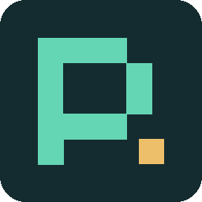
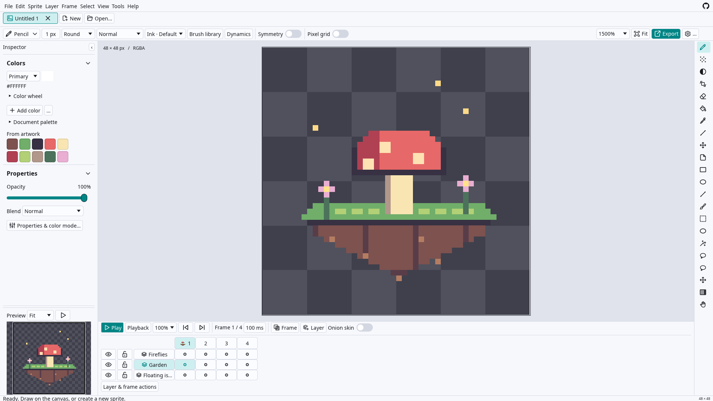

<p align="center">
  
</p>

<h1 align="center">PixelCraft</h1>

<p align="center">
  <b>Pixel art, sprites and animation, in a standalone desktop editor.</b><br>
  Draw frame by frame, build with tiles, and keep your layers editable.<br>
  Open source, local, and yours.
</p>

<p align="center">
  
  
  
  
</p>

<p align="center">
  <b>Made via <a href="https://github.com/storytold/craft-anything">CraftAnything</a> by <a href="https://getartcraft.com/">ArtCraft</a>.</b><br>
  An independent project created with Craft Anything's study, build and check workflow.
</p>

<p align="center">
  <a href="#get-started"><b>Build and run</b></a> ·
  <a href="https://github.com/storytold/craft-anything">Craft Anything</a> ·
  <a href="https://getartcraft.com/">ArtCraft</a> ·
  <a href="https://getartcraft.com/apps">The Crafting Apps</a>
</p>

<p align="center">
  <picture>
    <source media="(prefers-color-scheme: dark)" srcset="shots/pixelcraft.png">
    <source media="(prefers-color-scheme: light)" srcset="shots/pixelcraft-light.png">
    
  </picture>
  <br>
  <sub>The editor with its built-in garden sample: three layers, four frames, and editable pixel artwork.</sub>
</p>

<p align="center">
  <a href="#features">Features</a> ·
  <a href="#get-started">Get started</a> ·
  <a href="#editing">Editing</a> ·
  <a href="#projects-and-interchange">File formats</a> ·
  <a href="#independent-extensions-and-storage">Extensions</a> ·
  <a href="#status">Status</a> ·
  <a href="#license-and-credits">License and credits</a>
</p>

## Features

<table>
  <tr>
    <td width="33%" valign="top">
      <h3>Draw pixel by pixel</h3>
      Pencil, fill, shapes, selections and five brush shapes. Work in RGB, grayscale or indexed color, with editable palettes and undo.
    </td>
    <td width="33%" valign="top">
      <h3>Bring sprites to life</h3>
      Layers, groups, blend modes and cel opacity. Preview frames, name animation ranges, loop playback and paint with tiles.
    </td>
    <td width="33%" valign="top">
      <h3>Keep your work editable</h3>
    </td>
  </tr>
</table>


## Get started

### Windows installer (future releases)

Future tagged releases will include `PixelCraft-<version>-x86_64-Setup.exe` beside the Linux AppImage, with a SHA-256 checksum. On Windows 10/11 x64, open the installer, choose the install location and optional desktop shortcut, then launch PixelCraft from the Start menu. Installation is per user and requires no administrator access. Install newer versions over the existing installation; remove PixelCraft through Windows Settings → Apps. Uninstall keeps your projects, preferences and extensions in your user profile. Working OpenGL drivers are required. Installers are currently unsigned, so Windows may show a publisher warning.

### Windows portable executable


### Linux AppImage

Download the `.AppImage` from this repository's GitHub **Releases**, make it executable in your file manager, and open it. From a terminal:

```bash
chmod +x PixelCraft-*-x86_64.AppImage
./PixelCraft-v0.1.0-x86_64.AppImage
```

Use the filename you downloaded. Releases target Linux x86-64 with glibc 2.35 or newer (Ubuntu 22.04+), a graphical desktop and working OpenGL drivers. On Wayland, the app uses your system's Wayland libraries alongside its graphics drivers; these libraries are deliberately excluded from the AppImage. File dialogs use the desktop's XDG portal. If FUSE is unavailable, run the AppImage with `--appimage-extract-and-run` before any app arguments. A SHA-256 checksum accompanies each release.

### Linux tarball and Debian package

The Linux release job also builds a relocatable `PixelCraft-<version>-linux-x86_64.tar.gz` and an amd64 `.deb`, each with a SHA-256 checksum. Extract the tarball and run the `pixelcraft` launcher inside the extracted folder. Keep the launcher and its `usr` directory together.

On an apt-based distribution with the required libraries, install the Debian package from the download directory using the downloaded filename.

```sh
sudo apt install ./PixelCraft-vX.Y.Z-linux-amd64.deb
```

Open PixelCraft from the application menu or run `pixelcraft` in a terminal. The package uses the distribution's graphics and WebP libraries. Apt handles the declared runtime dependencies.

Maintainers: publish the contents of this `app/` directory as the repository root, including `.github/`. Push a version tag such as `v0.1.0` to run `.github/workflows/release.yml`. **Actions → Desktop releases → Run workflow** creates downloadable artifacts without publishing a release. Tagged runs publish all platform assets and checksums after the Windows, Linux, and macOS jobs pass. The version tag controls artifact filenames; update `Cargo.toml` and `Cargo.lock` before tagging a new app version.

The Linux job builds on Ubuntu22.04 and verifies AppImage, tarball and Debian package startup. Windows builds static WebP, tests the editor, and verifies its installed and standalone executables. Both native macOS architectures build and verify relocated application bundles. Automation uses native CLI/MCP operations and requires no bundled interpreter.

Before uploading a release, the workflow also opens the packaged AppImage on an Xvfb X11 display and a headless Weston Wayland display using Mesa software rendering. Each check must exit successfully and produce a nonblank editor screenshot within 60 seconds. Wayland runs without `DISPLAY` so it cannot fall back to X11. Screenshots and startup/compositor logs are saved in the `PixelCraft-startup-diagnostics` Actions artifact, including on failure. Packaging fails if any `libwayland-*.so*` files or symlinks enter the AppDir. These checks validate startup on the Ubuntu release runner; they do not cover every Linux distribution or graphics driver.


### macOS


The build applies an ad-hoc signature to the app bundle. Developer ID signing and Apple notarization require separate release credentials.

### Build from source

Build from the repository root with Rust1.95 and Cargo. Linux requires the graphics/window-system and WebP development libraries. Windows uses an x64 MSVC developer PowerShell and `./packaging/build-windows-webp.ps1`; macOS uses `bash packaging/build-macos-runtime.sh arm64` (or `x86_64`) for static WebP. No Lua toolchain or runtime is required.

```bash
cargo build --release
cargo run --release
```


The first build downloads dependencies. After Cargo has cached them, add `--offline` to build or run without network access. The release executable is `target/release/pixelcraft` on Linux or `target/release/pixelcraft.exe` on Windows.

The editor opens with an editable garden sample. Choose **File → New sprite** to start a transparent canvas, or open an existing project. Save your editable work as **.pixel**; use PNG, sprite-sheet or GIF export for sharing.

## Recovery and expanded workflows

Open tabs and unsaved documents are backed up locally every 15 seconds and at a confirmed exit, using a compressed, atomically replaced workspace file in PixelCraft's preferences directory. The previous backup is retained as a fallback. On startup PixelCraft reads the backup in the background and lists its documents in **Workspace recovery**. Restore or discard documents individually or together. Full restoration includes saved baselines, selections and canvas views. **Recover images** opens the chosen backup’s readable cels as layers or frames in a new unsaved sprite, including pixels from hidden layers. Autosave does not overwrite project files; Ctrl+S still saves your project. A crash can lose changes since the last backup. Screenshot/check runs do not read or write your session.

**Sprite → Canvas size…** changes the bounds of every layer and frame. Choose one of nine anchors or enter X and Y offsets. Reducing the canvas crops pixels and whole tiles outside its bounds. Partial tiles retain their grid alignment and flip flags. Undo restores the original canvas.

In **Sprite**, use **Sprite size…** to resample artwork and tilesets with nearest-neighbor filtering. **Auto-trim sprite** crops to the combined visible bounds of every frame. The whole-sprite rotate and flip commands transform all layers, frames and tile grids. **Duplicate sprite** opens an independent copy in a new tab. Resampling, trimming, rotation and flips run in the background and apply as one undoable edit.

In **Layer**, **Duplicate layer or group** copies the selected layer or group tree across all frames. **Merge down** bakes the selected layer and the sibling below it into one raster layer across all frames. It uses both layers’ blend modes and opacity, including artwork stored outside the canvas. Tile placements in the merged pair become pixels. The destination keeps its visibility and place in the stack. The bake combines the pair in isolation, so blend interactions with deeper layers can change. Both edits are undoable.

**Flatten visible layers** bakes the visible result across the animation and leaves hidden layers and groups editable. **Flatten all layers** also includes hidden artwork and replaces the layer stack. **Layer via copy** and **Layer via cut** place the current raster selection in a new sibling layer on the active frame. Use the chevron beside a timeline group to collapse its child rows.

Use **Layer → Convert to tilemap…** to divide a raster layer into editable tiles at the chosen width and height. Identical tiles share an entry across frames. **Convert to raster layer** turns a tilemap back into pixels or removes the background designation from a background layer. **Convert to background** fills transparency with the secondary color and moves the result to the bottom of the sprite. Indexed conversions preserve colors when the palette has enough room for any added entries.

**Edit → Drawing & selection studio** contains symmetry on either axis, a one-pixel pixel-perfect pencil, pressure-controlled brush size, numeric selection movement and nearest-neighbor resizing, 90° rotation, flips, crop, shading ramps and basic invert/grayscale/lighten/darken effects. Lasso **Q**, move **V** and gradient **D** also appear in the toolbar. Drag a gradient from the active color to the alternate color; both colors are editable in the studio. Pressure is applied when the window-system/tablet backend supplies force events; mouse strokes retain full brush size. Selection transforms and effects are undoable. Crop affects all image layers and frames; tile layers must be rasterized before cropping.

The **Colors** panel now supports renaming and deleting entries, and saving/loading named JSON palettes. Drawing colors and names are also preserved by session recovery. Shading ramps add named colors between the active and alternate colors.

**File → Export sprite sheet** opens a packing dialog: choose columns, transparent padding, border trimming, a named animation range, and an engine preset. Exports include PNG and JSON frame rectangles, original canvas sizes, trim offsets, millisecond durations and tags. Compact packing uses rows of trimmed frames without rotating them. Open the exported JSON to reconstruct full animation canvases, or use **File → Import PNG sequence** for naturally ordered numbered images of equal dimensions.

Choose **All frames and tags** to export one sheet with every tag. Keep **Trim transparent borders** off and reuse the same columns, padding, and scale when replacing artwork in an existing engine project. An artwork-only redraw then keeps each cell rectangle fixed. Inserting a frame can move later rectangles, but surviving frames retain their export names and IDs when you edit and save the same native project.

The **Unity** preset writes a multiple-sprite `.png.meta` with point filtering and retains an existing texture GUID on re-export. Keep the PNG, JSON, and meta file together in Assets. The Unity Editor importer uses the JSON's tags and millisecond durations to create and refresh clips in place. See the [Unity import walkthrough and test procedure](integrations/unity/README.md). Older PixelCraft exports of only one tag used sheet positions for Unity IDs, so test those references before replacing their metadata.

The **Godot** preset writes a Godot 4 SpriteFrames `.tres` with AtlasTexture frames, source margins, tag directions, and per-frame timing. Keep the PNG and resource at the same paths on re-export. The generated texture path points to the Godot project's `res://` root. Existing Godot resource UIDs and surviving AtlasTexture IDs are preserved when replacing the same resource file.

Choose **Unity + Godot** to export one PNG and JSON with both engine sidecars. Re-export uses the existing Unity GUID and Godot resource UID. The editor, CLI, and file MCP use the same preset.

The **Unreal Engine** editor integration uses Paper2D sprite sheet imports to create Flipbooks for every named tag, including custom tags. Reimporting the same sheet refreshes those Flipbooks in place with the exported durations. See the [Paper2D Flipbook walkthrough](integrations/unreal/README.md).

**Sprite → Tileset browser** shows clickable tile thumbnails and selects the corresponding tile layer for painting. Flip the brush horizontally or vertically and rotate square tiles in quarter turns. Duplicate tiles for independent edits, delete their placements across the shared tileset, or move a tile to another index while preserving its artwork and orientation in the map. Enable **Show tile indices on canvas** to see the active layer's IDs at readable zoom levels. **View → Seamless canvas** repeats the active frame horizontally, vertically, or on both axes. Pencil, eraser, shapes, fill, and color sampling work on the repeated tiles in the main canvas. Use **Fit canvas** to see the whole repeat pattern. **View → Split canvas** opens a second editable view of the same sprite. Drag the divider to resize the panes, and click either pane to target it with the zoom, Fit, and preview navigation controls. **View → Drawing grid settings** changes the grid origin and spacing, and **Set drawing grid from selection** uses the selected bounds. Enable **Snap to drawing grid** to align brush and shape input to the nearest grid intersection. Grid geometry is saved in PixelCraft and ASE projects. Use **File → Export tileset atlas** to save a PNG of authored tiles from selected or visible tilemap layers, including unused tiles. Layers sharing a tileset contribute it once. Mixed tile sizes are placed in transparent cells sized for the largest tile, with each tile aligned to the top left. For MCP or CLI exports, use `format: "tileset-atlas"` with a PNG output and optional zero-based `layers` and `columns`. The result includes the per-tileset offsets and cell dimensions.

Open finite orthogonal Tiled `.tmj` maps or `.tsj` image tilesets, and export the active frame through **File → Export Tiled map**; the export writes the map, external tilesets and PNG atlases with tile flips. Tiled image collections, infinite maps, object/group layers and compressed tile arrays are rejected explicitly. JSON array tile layers, tilesheet margins/spacing, layer offsets and opacity are supported.

Open animated GIF, APNG (including animated `.png`), WebP and layered OpenRaster `.ora` through **File → Open**. Animation timing and composited frame canvases are retained. OpenRaster keeps layers, groups, visibility, opacity, offsets and common source-over/multiply/screen/overlay/darken/lighten modes; other blend modes return an error. Its ZIP reader has a 32 MiB extraction budget. Windows and macOS link the WebP decoder into the executable. The Linux AppImage and tarball include libwebpdemux. Other Unix builds use a compatible system libwebpdemux. No external image conversion program is invoked.

## Editing

New Sprite, Rename Layer, save confirmations, file errors, and **Help → Tools and file support** use a shared dialog. Drag the header to move it, or use the highlighted **×**, Escape, or the dimmed area around it to dismiss it. Dismissing a save confirmation keeps your edits open.

Pencil B, eraser E, fill G, eyedropper I, line L, rectangle U, ellipse O, selection M, hand H. The compact **Colors** selector starts with one white entry, **Primary**. **Add Color** creates and selects another named entry; click its color chip to edit it. Selecting an entry makes it the active drawing color for either mouse button. **Dominant colors** groups similar nontransparent artwork shades across layers and frames into up to 10 representative swatches, ranked by frequency. Results are cached until artwork changes. Click a swatch to select the drawing color while keeping saved named colors unchanged. Drawing colors are shared across sprite tabs. Alt-click samples into the active entry; X swaps with the alternate color. Scroll zooms around the pointer; middle-drag pans. Ctrl+Z undoes; Ctrl+Y redoes; Ctrl+S saves. Copy/cut/paste/delete work on image-layer selections. A stroke is one undo step.

Select the paint bucket and open **Fill options** to set color tolerance or match disconnected areas. The wand keeps its own settings. On a tile layer, the bucket fills matching cells with the chosen tile, and the eyedropper picks a tile for placement.

Under **Colors → … → Color harmonies**, choose a complementary, analogous, triadic, or split-complementary swatch based on the active color.

Use **Edit → Replace Color** to change an exact color match in one Undo step. Choose which layers and frames to include and whether to limit the edit to the selection. The operation detaches any linked cel it changes so that replacements apply independently to each cel in scope. The drawing studio can include diagonal neighbors when outlining. **Edit → Settings** offers whole-pixel wheel zoom that keeps the cursor over the same artwork.

Use **Sprite → Properties, layers, tiles & ranges** (also available beside the timeline) for:

- RGB, grayscale with alpha, and indexed modes with editable 1–256-color palettes. Drawing is constrained to the selected mode; indexed palette slots retain their identity even when colors match. Use the active color chip to choose a drawing color, or select a used artwork swatch to reuse it. Imported animated palettes are retained.
- Groups and nested group membership, all 19 ASE blend modes, separate layer/cel opacity and cel stacking order. Parent visibility and locks apply to children. Groups composite separately. Layer removal and reordering retain membership.
- Importing PNG tilesheets using a chosen tile size, capturing a selection as a tile, and creating tile layers. Select a tile ID in Properties and use Pencil/Eraser to place/remove whole tiles. Tile references, tilesets and flip flags are preserved.
- Named frame tags/ranges, editable endpoints and forward/reverse/ping-pong playback. Frame insertion/deletion adjusts ranges. Select **Use for playback** to loop one range. The timeline shows thumbnails for frames already rendered or prefetched within the texture cache.

The context bar offers round, square, diamond, horizontal and vertical brushes. Ellipses use a symmetric integer rasterizer, including small and degenerate bounds. Pixel-exact agreement with every original editor brush mask is not claimed.

Canvases support up to 16384 pixels per side and 64 million pixels per canvas and 128 million stored pixels across layers and frames. Dimensions and project structures are validated. Cel pixels and indexed buffers use copy-on-write sharing across frame copies and undo snapshots. Undo retains up to 64 steps with a 192 MB allocation budget; a single oversized step is retained. Unchanged frame textures are cached and the checkerboard is clipped to the viewport.

### Timeline and scene editing

Open **Edit → Undo History** to jump to a named edit in the active sprite. You can move forward again until you make a new edit. The panel shows the history retained within the editor's Undo limits.

Use **Playback** on the timeline to loop selected frames, or play the selection, active tag, or whole sprite once. Nonadjacent selections skip unselected frames. **Play subtags** and **Play subtags once** start at the beginning of the active tag or sprite and follow the directions and repeat counts of nested tags. A nested tag with an unlimited repeat setting plays once per visit so playback can continue. **Rewind on stop** returns to the frame you were editing before playback started. With onion skin enabled, drag either end of the **Onion range** strip to change how many earlier or later frames appear. A focused handle also responds to the left and right arrow keys.

Use **Play preview animation** in the Preview panel to play the authored frame timings while the timeline stays on your editing frame. The timeline’s playback speed applies to both the canvas and the preview. Export uses the frame durations you authored. The preview shows the main canvas viewport. Click the artwork in the preview to center the canvas there. The timeline marks tagged frames, and **Sprite → Properties, layers, tiles & ranges** edits a tag’s repeat count for batch and engine exports.

- Click a frame header to select it. Shift-click another header for an interval, or Ctrl-click (Command-click on macOS) to toggle individual frames. Drag a selected header to an insertion marker to move the selected frames together. Use **Frame → Reverse frames** to reverse selected frames in their existing slots, or the entire timeline when no headers are selected. Both operations preserve sprite-sheet frame IDs and keep tag boundaries at their timeline positions.

- Shift-click layer names to select an interval, or Ctrl-click (Command-click on macOS) to select individual rows. Drag the selection to the top or bottom edge of another layer name to restack it, or to the middle of a group name to move it inside. A selected group carries its children, and the background stays at the bottom.

- Shift-click a timeline cel, or use Shift and the arrow keys with a cel focused, to select a rectangle. Ctrl-click (Command-click on macOS) to toggle individual cels. Drag a selected cel to move the selection, preserving gaps and the position of the grabbed cel within the selection. **Layer & frame actions → Selected cels** clears, links, unlinks, changes timing, or places a move or duplicate at the chosen destination. Each edit uses one Undo step.
- **Layer & frame actions → Link cel to frame** shares artwork within one layer. **Link duplicated cels** makes frame duplication link artwork on that layer. Unlink a cel before editing it independently.
- **Position and opacity keyframe** animates offsets and opacity. Position snaps to whole pixels. Linear keys interpolate using frame durations, including the loop boundary. Enable **Hold until next keyframe** to step between values.
- **Drawing & selection studio** has free-angle rotation with a draggable preview pivot. Choose Fast or RotSprite for the preview and applied rotation. The studio also offers masks from selection, levels, hue/saturation and palette remapping. An adjustment applies to the layers composited below it in its group. Use an empty image layer for an adjustment and its visibility control to toggle the effect.
- **Sprite → Palette and Color Conversion** offers Floyd-Steinberg error diffusion with a 0 to 100% strength control alongside nearest colors and ordered matrices. Conversion preserves frame palettes and matching authored indices, processes hidden artwork with visible neighbors, and applies through a cancellable worker. CLI and MCP document commands accept `convert-indexed` with `dithering='floyd-steinberg'`, a `factor` from 0 to 1, a `transparent` slot, and an optional RGBA `palette`.
- **Grayscale conversion** in Palette and Color Conversion offers Luminance, HSV Value, and HSL Lightness. Conversion resolves indexed slots against each frame's palette before computing gray values, keeps alpha and hidden artwork, preserves shared cel storage, and runs through the editor worker. CLI and MCP document commands accept `convert-grayscale` with `method='luma'`, `'hsv'`, or `'hsl'`. Luminance is the default. Choosing Grayscale in Sprite Properties also opens the worker preview before confirmation.
- **RGB conversion** is available in Palette and Color Conversion and Sprite Properties. It runs in the cancellable worker, resolves indexed slots against each frame's palette, retains hidden artwork, and preserves equivalent linked cel storage. CLI and MCP document commands accept `convert-rgb`. The editor applies conversion as one Undo step.
- **Indexed color fit** in Palette and Color Conversion offers Default, RGB, Linear RGB, CIE XYZ, and CIE Lab. Default preserves the existing squared RGBA matching. Explicit choices use the selected color space and a scaled alpha distance; palette coordinates are prepared once per palette. They work with nearest colors, ordered dithering, and Floyd-Steinberg. CLI and MCP `convert-indexed` accept `fit_criteria='default'|'rgb'|'linear-rgb'|'xyz'|'lab'`.
- **Color conversion previews** appear on the canvas after choosing Convert to Indexed, Grayscale, or RGB in Palette and Color Conversion. Changes to conversion settings refresh the active frame preview in the background; unrelated animation frames and unplaced tile definitions are excluded. Apply conversion processes the complete animation in the background before committing it. Turn off Show conversion preview to compare the original. Apply conversion commits one undoable edit; Cancel or Escape discards it. Grayscale and RGB choices in Sprite Properties also open a preview before confirmation. Preview pixels are never used for saving or export until applied.
- **Indexed tile artwork** retains authored palette slots through ASE/native saves and recovery, including duplicate-color entries. Native conversion, duplication, painting, palette sorting/reversal/ramps, flips and resampling preserve the corresponding slot data.
- **Tiles and frame palettes** use the active palette for canvas sampling, compositing, region updates and tileset previews. RGB/grayscale conversion resolves shared tiles with frame zero by default. Editor Preview/Apply uses the active frame; CLI/MCP convert-rgb and convert-grayscale accept an optional zero-based frame or cel_id. Raster cels retain their own frame palettes.
- **Tile clipboard palettes** retain visible source-frame colors and distinguish authored slots when matching definitions. Native paste as a sprite restores source mode and transparency; legacy descriptors remain readable. Native paste reconciles destination palettes while preserving compatible slots and masks. RGB/grayscale destinations clear indexed metadata.
- **Large tile clipboard operations** run copy/cut selection scans, snapshot building and paste/import preparation in cancellable workers. Scheduling accounts for source and destination size. Paste waits for pending copy; stale destinations and cuts are rejected, no-op pastes add no history, and Escape cancels pending work. Large tile and raster reference-image extraction also runs in the paste worker, preserving source masks, orientation and placement. Snapshot cloning and cancellation latency inside validation/hashing remain performance audit items.
- **Sprite Properties → Slices and pivots** edits frame-keyed game asset bounds and pivots. Tile painting modes in the same window support shared tile edits and placement variants. **Reuse placement variant** reuses matching artwork. **Always create variant** adds an independent tile per changed placement in a pencil or eraser stroke, even when the resulting artwork matches an existing tile. Both modes preserve placement orientation. In an MCP `edit-tile-pixel` command, set `variant_mode` to `shared`, `reuse-variant`, or `create-variant`.

Native projects save compact empty cels and sparse raster blocks. Copy-on-write buffers are written once per shared raster, and older dense native projects remain readable. Frame textures survive unrelated edits. During playback, PixelCraft prepares one upcoming frame in the background. If the next frame misses its deadline, the editor holds the current frame until the new one is ready. The texture cache targets 64 MiB and reserves space for the current and upcoming frames.

Save masks, adjustments and keyframes in `.pixel`. **File → Export baked ASE copy** flattens those effects into each frame and retains frame timing, tags, slices and the color profile. Keep the native project for editing.

## Projects and interchange

**`.pixel` is the default editable project format**, a versioned, compressed native document containing all editor properties, tiles, ranges, metadata, profiles and off-canvas image pixels. Saving uses a temporary file and replacement. New/open/close protect unsaved changes.

`.ase` and `.aseprite` are optional, native import/export formats. RGB, grayscale and indexed cels, raw/zlib/linked cels, groups, blend modes, cel opacity/order, embedded tilesets, tilemaps with per-cel geometry, palettes, tags, layer flags/UUIDs and opaque metadata chunks are supported. Unknown chunks retain their bytes and object association. ASE layers are serialized in hierarchy order. Image artwork beyond the canvas is retained and written back; normal canvas exports clip it.

PNG import/export retains text, gamma, chromaticities, profiles, EXIF, pixel density and timestamps. Export an active-frame PNG, horizontal PNG sprite sheet or animated GIF. GIF has binary transparency and 10 ms timing precision. ICC profiles are retained losslessly, and RGB/grayscale profiles and fixed-gamma sRGB are converted to sRGB for display with moxcms. Source pixels are unchanged.

External tilesets resolve relative to the project and are embedded on save. Sparse tileset IDs, off-grid/off-canvas tilemap geometry, linked tilemaps, compact 8/16-bit entries and legacy empty-tile encodings are supported. Missing references and unsupported future encodings return explicit errors. Arbitrary future metadata remains opaque; the editor does not interpret every external metadata schema. Prefer `.pixel` for preserving PixelCraft's full editable state.

The ASE implementation follows the [published format specification](https://github.com/aseprite/aseprite/blob/main/docs/ase-file-specs.md); no original program is required.

Imported ASE reference layers use their precise per-cel position and size in the editor. The canvas samples them at sprite resolution, and the eyedropper includes them when reference sampling is enabled. ASE and PixelCraft saves preserve the original cel and its placement. Raster artwork exports omit reference layers.

ASE imports apply the stored pixel aspect ratio to the canvas and Preview and use the stored drawing-grid origin and spacing. Edit both in **Sprite properties**. PixelCraft and ASE saves retain these settings. Raster export dimensions follow the sprite's pixel dimensions and export scale.

## Independent extensions and storage

**Edit → Search commands** (`Ctrl+Shift+P`, configurable) searches native menu commands and tools, including commands without shortcuts. Type a label or action ID, use arrows and Enter, or click a result. Escape cancels without editing the canvas. Current shortcuts and disabled states are shown; theme, density and recent-file variants retain their parameters. Lua/plugin commands are not registered.

**Extensions → Asset extensions** installs themes, palettes, shortcuts, languages and dithering matrices from ZIP/asset packages or folders. Archive validation rejects traversal, symlinks, encryption, invalid CRC and oversized contents. Lua scripting/plugins are no longer supported. Mixed packages retain independent assets and show a script-retirement warning. See [migration and CLI/MCP workflows](docs/native-automation-migration.md).


- Data and projects: `$XDG_DATA_HOME/pixelcraft/{extensions,projects}`, normally `~/.local/share/pixelcraft`.
- Preferences: `$XDG_CONFIG_HOME/pixelcraft`, normally `~/.config/pixelcraft`.
- `PIXELCRAFT_HOME` optionally sets an independent portable root, with preferences beneath `preferences/`.
- AppData is used when present as a fallback. There is no migration or lookup of another editor's settings.

New installs follow the system appearance. Choose **View → Theme → System, Light, or Dark** to change and remember the appearance; existing Light and Dark choices are preserved.
On Linux, System mode reads the desktop appearance portal and listens for changes while the editor is open (on both X11 and Wayland). If the desktop provides no appearance preference, System mode uses Light.

Themes accept original XML color definitions or JSON with `dark`, `panel`, `text`, `accent` (RGB arrays). Palettes are JSON arrays of RGBA bytes, GIMP `.gpl` palettes, or ASE palettes. Shortcuts accept original `.aseprite-keys`/XML files for supported commands and tools, or JSON maps such as `{"P":"pencil","Ctrl+S":"save"}`; supported actions include tools, file/edit commands and playback. Applied theme/shortcut settings are copied into PixelCraft's preferences and remembered.


### Native automation and asset compatibility

Use `pixelcraft --help` to discover CLI operations, or connect an external client with `pixelcraft --mcp`. Typed native requests create and inspect documents, edit pixels, apply command batches, manage layers/frames/tags, convert palettes, and export artwork. File tools support revision checks. MCP file tools additionally enforce explicit overwrite permission and can be restricted with `--project-root`.

For an open editor, enable live assistant access in Workflow tools and use the displayed connection command. Refresh the document revision and target IDs after edits or structural changes. Live command batches support preview and commit as a single Undo step. Expired or disconnected live requests are discarded before commit.

See [supported interfaces and asset formats](COMPATIBILITY.md) and the [native automation guide and runnable example](docs/native-automation-migration.md) for request examples and limits.

## Verification

Pull requests run formatting, strict Clippy, and Rust tests on Linux, Windows, and both macOS architectures. Windows and macOS checks also verify graphical startup and standalone or packaged operation. Tagged builds run the separate release packaging workflow and test the downloadable packages.


## Status


## License and credits

PixelCraft is licensed under the [MIT License](LICENSE).

**Made via [CraftAnything](https://github.com/storytold/craft-anything) by [ArtCraft](https://getartcraft.com/).** Craft Anything provided the workflow used to study the reference application, build this independent editor and check the result.

PixelCraft was created using [Aseprite](https://github.com/aseprite/aseprite) as its basis and reference for pixel-art editing features, file compatibility. Thank you to the Aseprite developers and contributors.


<p align="center">
  <a href="https://github.com/storytold/craft-anything">Made with CraftAnything</a> ·
  <a href="https://getartcraft.com/">ArtCraft</a> ·
  <a href="https://getartcraft.com/apps">Explore the Crafting Apps</a>
</p>

## About and updates

Open **Edit → Settings** to set new sprite size, the default pixel grid, interface scale, checkerboard, onion skin, recovery, and update preferences. **Reset settings to defaults** restores those defaults. Enable **Download and verify updates in the background** to show **Update ready** once the download passes verification. Open the notification to review and install it when you are ready.

**Help → About** shows the developer, installed version (from Cargo), latest stable GitHub release, and a download link when an update is available. The GitHub icon beside PixelCraft opens the project repository. A centered **New version found** notice opens the update controls when a newer release is confirmed. Checks run in the background at startup, hourly while the editor is open, and through **Check for updates**; failed checks never announce an update.

The developer credit defaults to Asad, the author recorded in `Cargo.toml`. Tagged GitHub Actions builds automatically embed their repository and keep this developer credit. For local builds, set `PIXELCRAFT_REPOSITORY=owner/repository` and optionally `PIXELCRAFT_DEVELOPER` when building. The About dialog includes a read-only Developer and repository section, without editable fields or a save button. Previously saved developer and repository values in `about.json` are ignored; the build identity always supplies these fields. No repository URL was present in the source project, so local builds require the build-time repository setting before GitHub links and release checks can work.

The GitHub mark in `assets/github-mark.svg` is from [GitHub Octicons](https://github.com/primer/octicons), licensed under the MIT License; the PNG is a rendered copy.

## Workflow tools and automation

Open **Tools…** beside the brush controls, or **Edit → Brushes, references & workflow tools**.

- **Magic Wand (W)** selects matching pixels on the active layer. Choose contiguous or whole-layer matching, tolerance (0–255 per RGBA channel), and Replace/Add/Subtract. Shift-click adds; Ctrl/Cmd-click subtracts. Transparent pixels match regardless of hidden RGB. Selection masks work with painting, copy/cut/delete, shapes and transforms.
- **Shade** steps each painted pixel once per stroke through the document palette. Choose its direction on the drawing bar. **Dither** alternates the active and alternate colors on a checkerboard anchored to canvas coordinates. **Selection** stamps captured selection pixels, including partial alpha and transparent pixels that erase their destination. Capture deselects the source so the stamp can be painted elsewhere.
- **Wrap drawing & fill** makes the canvas a torus. Strokes can extend past its edges, and flood fill connects matching pixels across opposite edges. The seamless canvas uses the axes selected under **View** while it is active.
- **Reference images** imports PNG/JPEG overlays. Set X/Y, scale, visibility and opacity, or enable Move/scale and drag on canvas (Shift-drag scales). Finish moving to draw again. Images and placement are embedded in `.pixel` projects and recovery; artwork PNG, GIF, sprite sheets and atlases exclude them. Save `.pixel` to preserve editor-only reference data.
- **Palette tools** optionally snap RGB pencil, fill and shapes to the document palette. Import/export `.hex`, JASC `.pal`, GIMP `.gpl` and JSON. HEX accepts RRGGBB or RRGGBBAA; PAL/GPL contain RGB only. Drag document swatches to reorder them. The named drawing-color JSON palette remains available in Colors.
- **Onion skin** supports 0–8 previous and 0–8 next frames, each side with its own tint and opacity. More distant frames fade by distance. Settings are remembered.
- **Grid sprite-sheet import** accepts PNG, JPEG, BMP, or GIF (first image). Set cell dimensions or derive them from row and column counts after offsets and spacing. The preview follows the chosen row-major or column-major order. Enable partial edge cells to include them with transparent padding, or skip cells with no visible pixels. Imported frames use the chosen initial duration. Static indexed and grayscale PNGs retain their mode and original palette slots when representable.
- **File → Import as Layer** adds a raster image to the current frame in a layer named after the file. The image starts at the canvas's top-left, crops at the right and bottom edges, and leaves uncovered canvas pixels transparent. Animated sources use their first frame. Undo removes the import in one step.
- **Batch tag export** writes one GIF or PNG/JSON sheet per animation tag. GIFs contain the requested forward, reverse or ping-pong playback order and original durations (subject to GIF's 10 ms precision). Sheets retain direction metadata and reuse the current columns/padding/trim and Generic/Godot/Unity options. Indexed filename prefixes avoid name collisions and unsafe tag names.
- **Multi-file atlas** packs every frame of selected sprites with Rows or MaxRects, optional trimming, padding, exact pixel deduplication and power-of-two dimensions. Add sprites from successive selections, enter file or folder paths, and remove individual inputs. Relative paths start in the current sprite's folder when it has one. Preview the packed image and its dimensions before saving. Choose a JSON array, a JSON object keyed by stable frame filename, or PNG only. In the CLI or MCP atlas options, use `"metadata":"array"`, `"metadata":"hash"`, or `"metadata":"none"`. JSON keeps every frame's timing, source identity, original canvas size, trim offsets and source tags even when frames share one packed region. The global `meta.frameTags` ranges address the exported timeline and carry source IDs. The width is an upper bound. Power-of-two mode uses a width no larger than that bound.
- **File → Recent files** remembers the last 15 successfully opened or saved files. Duplicate filenames show a folder hint and missing files are marked. Workflow tools also provide PixelCraft, Aseprite and Photoshop shortcut presets for supported commands and an editable binding list. Choosing a preset replaces the current bindings; edits and removals are saved.

Double-click a timeline frame number or choose **Rename current frame** under **Layer & frame actions**. Names are saved in `.pixel` projects and exported as optional `frameName` entries in sheet and atlas JSON, with the existing filenames and IDs preserved.

Choose **File → Repeat Last Export** to render a sprite again using its last successful export destination and settings. Each open tab keeps its own export history for the current editor session. Repeat reads the current artwork, and remembers the original frame for single-frame exports. PNG sequence repeats update the frame files for the current timeline and leave other files in the destination folder.

Still PNG imports preserve indexed palette slots and transparency, or open grayscale files in Grayscale mode. Full-frame, cropped, horizontal sheet, packed sprite-sheet, and PNG sequence exports retain the document's PNG color mode when the rendered pixels fit it. This includes file and live MCP exports. Opening a PNG sprite sheet through its JSON companion also preserves color mode and applicable palette slots. If the colors require RGBA, the export uses RGBA to preserve the appearance.

Animated PNG imports retain grayscale or indexed mode where possible, along with frame delays and color metadata. Indexed animation keeps original palette slots and can add exact blended colors to unused slots. Imports that exceed indexed capacity use RGBA.

The editor opens and exports ICO, QOI, and TGA. It also exports lossless WebP and JPEG. JPEG composites transparency on white. ICO accepts up to 256 × 256 pixels after scaling. Static WebP opens with the built-in decoder. Use the same extensions in CLI, file MCP, and live MCP raster export.

PCX import reads indexed and planar RGB artwork. A single opaque indexed layer exports with its palette indices. Other PCX exports use 24-bit RGB with transparency composited on white. PCX is available in the editor, CLI, and both MCP export paths.

**Export SVG** and **Export CSS** write the selected frame as crisp, scaled pixel art with transparency. SVG files use rectangles. CSS files define the `.pixel-art` class, ready to attach to an empty element such as `<div class="pixel-art"></div>`. CLI and MCP accept `svg` and `css` as export formats and support layer filtering and cropping.

The editor and headless import tools open 8-bit FLI and FLC animations as indexed sprites. Import preserves palette changes and frame timing. Loop-transition frames stored after the authored timeline are skipped. Export both formats from the editor, CLI, or MCP. FLC supports custom dimensions and per-frame delays. Classic FLI uses 320 × 200 output, 6-bit color channels, and timing in 1/70-second ticks. Longer holds can repeat frames. Both formats use up to 256 colors per frame and composite transparency on white.

PSD and PSB import opens 8-, 16-, and 32-bit RGB and grayscale Photoshop documents and 8-bit indexed documents. Raster layers, groups, Unicode names, opacity, and raster masks remain editable. Indexed documents retain their palette slots and any declared transparent index. The importer reads raw, PackBits, ZIP, and ZIP-predicted image channels and converts higher-precision samples to the 8-bit canvas. It retains supported ICC profiles from 8- and 16-bit inputs. For visible clipping, supported adjustment tags, or fills that lack raster data, PixelCraft displays the embedded composite when the file provides one and preserves the imported raster layers in a hidden group. With no usable composite, these documents open using their available raster layers. Merged previews honor transparency markers and skip saved selection channels.

### Headless CLI

No graphical display is needed. `pixelcraft --help` lists the operations and arguments. Run `--cli OPERATION` with a JSON argument object, or named flags; command errors go to stderr and exit with a nonzero status. Layer/frame indices are zero-based.

```sh
pixelcraft --cli inspect --input hero.pixel
pixelcraft --cli export --input hero.pixel --output hero.gif
pixelcraft --cli export --input hero.pixel --output hero.png --format sheet --options '{"preset":"Godot","columns":8,"trim":true}'
pixelcraft --cli import-grid --input sheet.png --output animation.pixel --options '{"width":16,"height":16,"offset_x":1,"spacing_x":2,"skip_transparent":true,"duration":120}'
pixelcraft --cli import-sequence --inputs '["walk1.png","walk2.png"]' --output walk.pixel
pixelcraft --cli batch-tags --input hero.pixel --output exports --format gif
pixelcraft --cli atlas --inputs '["hero.pixel","enemy.aseprite"]' --output atlas.png --options '{"layout":"MaxRects","width":1024,"padding":2,"trim":true,"deduplicate":true,"power_of_two":true}'
pixelcraft --cli palette-export --input hero.pixel --output colors.hex
pixelcraft --cli palette-import --input hero.pixel --palette colors.pal --output recolored.pixel
pixelcraft --cli palette-convert --input colors.hex --output colors.gpl
```

`import`/`export` convert formats using the same loaders and exporters as the editor. `render` writes a PNG when output is supplied, or returns an inline PNG otherwise. `edit` accepts `input`, `output`, the `revision` returned by inspect, and `edits: [{layer,frame,x,y,color:[r,g,b,a]}]`. Edits validate completely before saving; locked layers, invalid coordinates and stale revisions fail without changing the input.

For a filtered sprite sheet, pass `--layers '[2,5]'` and set `frame_range` to an inclusive pair in `--options`, such as `{"frame_range":[6,11]}`. An explicit group includes its visible descendants. An explicitly selected layer can be exported even when hidden. Ancestor masks, opacity, and blending still apply. The range intersects any selected tag. The editor's **Export sprite sheet** dialog uses the timeline's current layer selection and displays frame numbers starting at one. File MCP accepts the same export arguments as the CLI.

To crop a sheet to a named slice, choose it in the editor's **Crop to slice** menu or pass `--options '{"slice":"Portrait"}'`. The export follows the slice keys across the selected frames and transparently pads any part outside the canvas. CLI and MCP accept the exact slice name.

Enable **Split layers into samples** or **Split by drawing grid** in the sheet dialog. The corresponding CLI and file MCP options are `split_layers` and `split_grid`. Layer splits include visible raster and tilemap layers, with parent opacity and masks applied. Grid splits use complete cells from the sprite drawing grid. When you also crop to a named slice, the grid is relative to the cropped canvas. The JSON records the original frame IDs and layer or grid coordinates, while each sample has its own export name. Tag ranges are emitted separately per layer or cell.

In **Export names**, use a frame filename template to name the sprite entries and a tag template to name the exported animations. For CLI and file MCP, use `filename_template` and `tag_template` in the sheet options. For example, `{"filename_template":"{title}_{tag}_{frame_id}","tag_template":"{tag}_{from}_{to}"}` retains stable frame IDs in the names. `{title}`, `{name}`, and `{extension}` describe the destination sheet. Use `{frame}` for the zero-based source frame, `{frame001}` for one-based numbering padded to three digits, or `{sample}` for the default export name. Other fields include `{frame_name}`, `{duration}`, `{innertag}`, `{outertag}`, `{tagframe}`, `{layer}`, `{layer_index}`, `{group}`, `{slice}`, `{grid_x}`, and `{grid_y}`. Tag templates also support `{from}` and `{to}` in the exported sheet's frame order. Duplicate generated names are rejected.

Sprite sheets can set **Border**, **Shape**, and **Inner** padding independently. Border is the outer atlas margin, shape is the gap between samples, and inner adds transparent space around each sample and any extruded edge. The metadata rectangles describe the sprite pixels so sheets still reimport at their original frame dimensions. In CLI and file MCP, use `border_padding`, `shape_padding`, and `inner_padding` in the sheet options. The legacy `padding` value supplies both border and shape when their individual values are omitted. **Align trim to drawing grid** (`trim_by_grid`) extends trimmed bounds to the configured grid lines and clips them to the canvas.

Choose **Rows**, **Columns**, **Horizontal strip**, **Vertical strip**, or **Packed**. Rows and columns can wrap at the configured maximum count or sheet edge. Packed arranges samples without rotating them. Set width, height, or both to reserve an exact canvas in pixels before export scaling. In the sheet options, use `layout` with `rows`, `columns`, `horizontal`, `vertical`, or `packed`. Set `width` and `height` only for the axes you want to fix.

For one sheet per authored slice, pass an output directory and enable `split_slices`. Each sheet follows its slice’s keyed bounds and preserves the included frame timing. Add `extrude` to duplicate each frame’s edge pixels before scaling. The border sits outside the sprite rectangle in the JSON.

```bash
pixelcraft --cli export --input hero.pixel --output slice-sheets --format sheet --options '{"split_slices":true,"extrude":1}'
```

### MCP and live editor access

Configure an MCP client to launch the executable with `--mcp`. The newline-delimited stdio JSON-RPC server advertises file inspection, PNG rendering, revision-checked edits, import/export, palettes, tag batches and atlases. Rendering returns an MCP image. File tools operate on explicitly supplied local paths and do not require the editor to be open.

Add `--project-root DIRECTORY` to restrict file tools and explicit live output paths to a project directory. Relative paths resolve from that directory. Absolute paths must be under the canonical root, including companion files referenced by imports. Linux requires `openat2` and Landlock ABI 3 or newer (Linux 6.2 or newer with Landlock enabled). Linux resolves relative symlinks beneath the root and blocks publication if a destination directory moves outside the root. Windows uses directory-relative handles and rejects junctions and other reparse points. If the platform or filesystem cannot enforce the restriction, the operation fails. This option works with `--live BRIDGE_CONFIG` from the same version of PixelCraft.

Restricted imports reject files with multiple hard links. Copy those inputs into the project as regular files. A separate process with write access inside a Linux project can still change the final filename between PixelCraft's identity check and a rename or removal.

MCP file writes require `"overwrite": true` to replace an existing file. This applies to every generated atlas, sprite-sheet, and batch sidecar.

Live access starts **disabled** and is never restored from preferences. Enable **Workflow tools → Assistants & headless tools → Allow assistants to access this live editor**. The editor displays an MCP command with `--live BRIDGE_CONFIG`. That instance adds `live-inspect`, `live-render`, `live-edit` and `live-undo`. The bridge listens on loopback with a random token in a private file, which is removed when access is disabled or the editor closes. Disable the checkbox to revoke access.

Live inspection returns a session/document revision. Supply that exact revision to edit or undo; user edits, undo/redo and document changes invalidate it. Assistant changes are one regular undo step. Active gestures and pending document operations block edits, and expired requests are discarded rather than applied after a stalled editor resumes. Reference overlays are excluded from assistant artwork rendering too.

Live inspection reports the session, document and layer IDs. Use `live-cel-targets` with a layer ID, start frame and count to look up cel IDs. Commands accept `layer_id` and `cel_id` alongside the existing index-based API. IDs are scoped to the open document. Refresh them after reopening a file or after structural document edits.

Send an identical command batch to `live-preview-commands` and `live-commands` with the same `revision` and optional `document_id`. Preview returns PNG and changed RGBA cel bounds, without adding an Undo step. If the revision or target changes, inspect again before applying. To get a PNG of the applied result in the same response, set `return_preview: true` on `live-commands` or `live-edit`. The optional `frame`, `layers`, `region` and `scale` select the view. The preview and changed bounds carry the committed revision. A preview error rejects the whole edit before it commits. If the reply would exceed the 8 MB live bridge limit, request a smaller crop, use a lower scale, or omit the preview. Live undo, redo, and saves also check reply size before changing history or publishing a file.

Pass a unique `job_id` to `live-export`. While the request is running, call `live-export-progress` or `live-cancel-export` with that same ID. The editor also shows progress and a Cancel export button. Cancellation is cooperative between frames and is rejected once publication starts. Revocation, expiry, or a disconnected bridge client discards staged work that has yet to publish.

#### Live pixel painting

Use `live-save` with the revision from `live-inspect` to write the active sprite to its current project path. Use `live-save-as` with `revision` and an `output` path to name an untitled sprite or save a copy. The editor adopts the new path after the file is saved. File MCP also supports `save` and `save-as` with an explicit `input` and its file revision. The user-selected current project path remains available to revision-checked `live-save` without an overwrite flag. Paths adopted by a restricted `live-save-as` retain their project-root restriction, including in recovered tabs.

In the **File** menu, choose **Export animation GIF…** or **Export video MP4…** and select a scale. Both use integer nearest-neighbor scaling. The same options are available through `live-export` with `revision`, `output`, and optional `scale`. The file MCP `export` tool takes `input` instead of a live revision. The extension selects PNG, GIF, or MP4 for live export. For example, a 480×270 sprite exported with `scale:4` produces 1920×1080.

Use the CLI `batch` operation or MCP `batch` tool to run ordered file exports in one invocation. Pass `steps` with an `operation` and its usual `arguments` for each export. Supported operations are `export`, `render` with a file output, `atlas`, `batch-tags`, and `palette-export`. Set `dry_run: true` to list output paths, including generated metadata and engine sidecars, before writing. The batch checks all planned destinations before encoding, then runs each export in order. An encoding failure stops later steps and reports how many steps completed.

For individual PNG frames, use **File → Export PNG sequence…**, choose an integer scale, and name a new folder under the destination. PixelCraft writes `frame-0001.png`, `frame-0002.png`, and so on in timeline order. PNGs retain transparency. Use `live-export` with `{"revision":"…","format":"png-sequence","output":"C:/path/new-folder","scale":4}`, or use file MCP `export` with `input` in place of `revision`. Use a new directory under an existing parent. MCP can also re-export to an existing directory with `"overwrite": true`, replacing only the generated frames. Pass `layers` to filter PNG, PNG sequence, GIF, or MP4 exports. PNG sequences also accept a `region` crop.


GIF keeps the timeline delays at GIF's centisecond precision. MP4 writes H.264 at 60 fps, rounds frame boundaries to video ticks, composites transparency onto black, and pads odd dimensions by one pixel for compatibility. Install FFmpeg with `libx264` and make it available on the editor or MCP process's PATH for video export.

Use `live-inspect` to get the active sprite revision and zero-based layer indices. Send an ordered `live-commands` batch with that revision. Batches are atomic and are visible in the editor as each batch commits. Use the revision returned by the batch for the next edit or preview. `changed_cels` describes the bounding rectangles of changed RGBA pixels in the resulting cel slots. Layer or frame structure and property changes are reflected in the returned sprite metadata.

Paint commands target an unlocked image layer and an explicit zero-based frame. Fill, outline, and shadow also accept indexed and grayscale image layers.

| Command | Arguments and behavior |
| --- | --- |
| `blit` | `x,y,width,height,data`. Data is straight RGBA8, row-major, encoded with `base64` (default) or `base64-zlib`. Destination clips to the canvas. `mode` is `source-over` (default), `replace` (transparent pixels clear), `multiply`, or `screen`. Patch dimensions are 1–1024 pixels on each axis. |
| `stroke` | `points:[[x,y],...]`, `color:[r,g,b,a]`, optional `size`, `end_size` for a taper, `brush_shape`, and integer `spacing` in raster steps. Set `placements:true` for explicit dab positions. Add `scatter`, `seed`, and `ramp` for reproducible palette variation. Use `alternate` for checker dithering, `shade:true` for palette stepping, or a `stamp:{width,height,data,encoding}` bitmap. Brush dabs default to `replace`, bitmap stamps default to `source-over`, and both accept `mode` and `opacity` (0–255). Supply `pressure:[0,...,255]` with one value per point to control a non-bitmap brush’s size, interpolated along the path. `mask:{x,y,width,height,data}` clips dabs to a packed selection. With no `points`, the brush places dabs at selected grid positions using `spacing` on both axes. |
| `polygon` | `points` and `color`, with optional `alternate` for checker dithering. Add `dither_level` (0–16) for a canvas-aligned 4×4 ordered pattern. Uses the editor's pixel-center fill rule. Add `edge_noise` (0–16 pixels) and `seed` to break up the inner edge reproducibly. |
| `fill` | `x,y,color` with optional `tolerance` (0–255, default 0). The default visits connected matching pixels. Use `contiguous:false` for all matching pixels on the cel. |
| `outline` | `color` adds a one-pixel outline behind the cel. Set `corners:true` to include diagonal neighbors. |
| `shadow` | `color` adds a shadow behind the cel. Use `offset:[dx,dy]` with signed pixel offsets, default `[1,1]`. |
| `clear-region` | `x,y,width,height`. Clears the clipped rectangle. Supply `mask` and/or `skip_transparent:true` to restrict clearing. |
| `copy-region`, `move-region` | Source `x,y,width,height` and destination `to_x,to_y`. Use `from_layer` and `from_frame` for a different source cel, and optionally `flip_x`, `flip_y`, `skip_transparent`, `opacity` (0–255 multiplier), or exact RGBA `colors:[[from,to],...]` mappings. The destination is clipped. A move clears the source rectangle before writing the saved source pixels. |
| `recolor-region` | `x,y,width,height`, `colors`, and optional `opacity` and `skip_transparent`. |

Bitmap stamps accept integer `scale` (1–16, up to 256×256 after scaling). Clear, copy, move, and recolor accept an optional base64 `mask` packed in row-major order with bit 0 first in each byte. Stroke masks use the same encoding in their `data` field. Each live request is limited to a 4 MB bridge message. Bulk operations also share a decoded work limit, so split large passes into a few meaningful batches.

Use `live-render` with `revision`, `frame`, optional `layers:[...]`, `region:{x,y,width,height}`, and integer `scale` to inspect the exact committed snapshot. It returns a PNG and render metadata. For a 480×270 canvas, call `live-export` with that revision, a new PNG `output` path, and `scale:4` for a 1920×1080 export. The export uses nearest-neighbor scaling. `live-undo` and `live-redo` accept the current revision and use the regular editor history.

`cargo test --offline` covers shared operations, masks, stamp transparency, shade replay, tag timing/direction, atlas reconstruction, revision guards, undo and expiry. `python3 checks/productivity-headless.py` checks the executable CLI and MCP with display variables removed. The separate loopback authentication test is ignored in the restricted build sandbox; run `cargo test --test productivity live_bridge_authentication -- --ignored` in a normal desktop environment to exercise the socket transport.


## Clipboard, display and export controls

Copy/Cut/Paste now exchanges RGBA images with the system clipboard, retaining transparent and partially transparent pixels. Linux Wayland uses `wl-copy`/`wl-paste` when installed (the `wl-clipboard` package), with XWayland clipboard fallback; Windows, macOS and X11 use native image clipboard access. Undo and Redo restore the selection rectangle, mask, layer and frame together with artwork.

In **Workflow tools**, **Export scaling** offers 1×, 2×, 4× or a custom positive integer. The same scale applies to PNG, BMP and sprite-sheet exports; sheet coordinates and source sizes scale with the PNG. **File → Export BMP** exports the active frame. Folders can be added to atlas inputs (including supported sprites in subfolders), and dropping files opens them as document tabs.

**Drawing & selection studio** adds Outline and Drop shadow using the active color, clipped to the active rectangle/mask. Shadow uses the studio's X/Y movement offsets. Reference controls add behind-art placement, fit-to-canvas, floating draggable previews with click-to-sample color, and copy-to-layer. Copying rasterizes the current reference placement and opacity as one Undo step. Enable **Sample reference colors** to include references in eyedropper sampling; transparency and behind-art placement are respected.

**Interface density & panels.** Compact is the default, with 14-point body/button text, 16-point section headings, 28-point controls, a 52-point tool rail and 30-point swatches. Dimensions are logical display units: 100% interface zoom follows the operating system's display scale. Choose **View → Density → Compact / Comfortable** (also in **Workflow tools → Interface & autosave**) to change spacing without changing text size. Your density and explicit interface zoom are remembered.

Drag the inspector's right edge or the timeline's top edge to resize them; their initial sizes are 264 and 200 logical points. The inspector header’s collapse button and **View → Show / Hide inspector** collapse and restore it. When hidden, a small restore button remains at the left edge. Windows and Linux use native window decorations; the operating system handles dragging, resizing, window controls and title-bar double-click behavior. Native close requests retain the save/discard/cancel confirmation for every unsaved tab. The inspector keeps its left dock on small windows; its preview stays pinned at the bottom while colors and properties scroll above it. Secondary drawing settings move into **Drawing…** when needed. Narrow timelines keep frame/layer creation and duration settings in **Layer & frame actions**. Tool and timeline contents scroll when they exceed the available space; the canvas fills the remaining area.

Custom switches, inspector section headings, and artwork swatches show hover and pressed feedback and a visible keyboard-focus outline. Artwork swatches announce their hex color and selected state to screen readers. Translucent swatches include alpha in the hex value. In the Edit menu, Undo and Redo are available when the active tab has the corresponding history.

**Palette order & ramps** moves swatches by zero-based position and adds intermediate shades between existing palette endpoints. Indexed swatch moves remap indices, including the transparent slot, so existing artwork keeps its colors. Ramps append shades without changing existing slots. Palette changes can be undone; documents with differently sized frame palettes report an error instead of altering artwork. **Interface & autosave** remembers interface scale, checker size/colors and recovery autosave on/off.

The app starts with wgpu and automatically retries OpenGL if graphics initialization fails. Set `PIXELCRAFT_OPENGL=1` to select OpenGL explicitly. Fallback never restarts an already running editor after an application error.

**Help → About** offers optional in-app update downloads for published x86-64 Windows/Linux assets. Downloads must include a matching SHA-256 sidecar and belong to the configured GitHub repository. Installation rechecks the bytes and requires confirmation. Windows starts the installer; Linux replaces the chosen AppImage atomically, retaining a `.previous` backup. Reopen the app after installation. This source build needs a build-time repository identity for release discovery; update networking/installation on other desktops has not been exercised locally.

Sprite-sheet JSON now retains tag repeat counts. Godot animations use unique names; repeat 0 loops indefinitely, while positive counts export a finite sequence with looping disabled. The exporter rejects finite sequences larger than one million entries.

### Assistant document commands

File tools add `create` (`width`, `height`, `output`, which must not already exist) and `commands` (`input`, `output`, `revision`, `commands`). Both `create` and `live-create` accept an optional `background:[r,g,b,a]` for the initial layer. Live tools add `live-create` and `live-commands`, both requiring the current live revision. `live-create` opens a separate untitled sprite and preserves the original tab. Live changes support Undo. A command batch validates transactionally and leaves the source unchanged on any error.

Use `add-layer` or `add-group` with an optional `name` and `parent` group index. Use `set-layer` to change `name`, `visible`, `locked`, `opacity`, `blend` (for example `"Multiply"`), or `parent`. Use `parent:null` to move a layer to the root, or use `parent_id` instead of an index with live tools. Layer indices are zero-based. `move-layer` uses `to`, and `remove-layer` uses `layer`. Removing a group moves its children into the group's former parent.

`add-frame` inserts after `frame` and accepts `duplicate`. `set-frame` accepts a name or duration in milliseconds. Tag creation and update accept `tag:{name,from,to,direction,repeat,color}` (direction 0–3, repeat 0 for infinite, RGB color). Tag update and removal use `index`. `shape` accepts `layer`, `frame`, `kind` (`line`, `rectangle`, `ellipse`), canvas coordinates `x,y,x2,y2`, RGBA `color`, and optional `filled`. File raster export accepts `scale`, and sheet export accepts `options.scale`.

Preview stays docked at the bottom-left independently of the inspector scroll area. Drag its top divider to resize it vertically. Choose Fit to show the whole sprite, or 1:1, 2×, 3×, 4× and 8× for sharp nearest-neighbor zoom measured in display pixels; drag overflowing artwork to pan. Preview height and zoom are remembered across restarts, and the image follows the active sprite and animation frame.

The bottom-left preview uses the inspector width and has a draggable top divider. Its zoom menu offers Fit, 1:1, 2×, 3×, 4× and 8×. Fit shows the entire sprite; fixed zoom preserves physical pixel sizes, with drag-to-pan for oversized artwork. Preview height and zoom are remembered separately from the main canvas.
