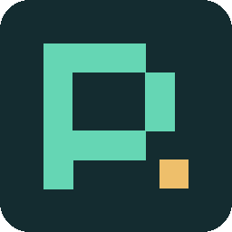
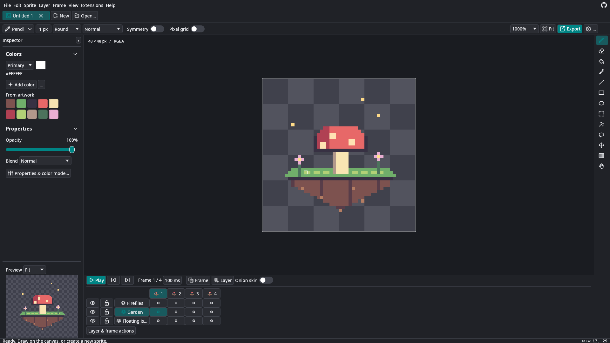

<p align="center">
  
</p>

<h1 align="center">PixelCraft</h1>

<p align="center">
  <b>Pixel art, sprites and animation, in a standalone desktop editor.</b><br>
  Draw frame by frame, build with tiles, and keep your layers editable.<br>
  Open source, local, and yours.
</p>

<p align="center">
  
  
  
  
</p>

<p align="center">
  <b>Made via <a href="https://github.com/storytold/craft-anything">CraftAnything</a> by <a href="https://getartcraft.com/">ArtCraft</a>.</b><br>
  An independent project created with Craft Anything's study, build and check workflow.
</p>

<p align="center">
  <a href="#get-started"><b>Build and run</b></a> ·
  <a href="https://github.com/storytold/craft-anything">Craft Anything</a> ·
  <a href="https://getartcraft.com/">ArtCraft</a> ·
  <a href="https://getartcraft.com/apps">The Crafting Apps</a>
</p>

<p align="center">
  
  <br>
  <sub>The editor with its built-in garden sample: three layers, four frames, and editable pixel artwork.</sub>
</p>

<p align="center">
  <a href="#features">Features</a> ·
  <a href="#get-started">Get started</a> ·
  <a href="#editing">Editing</a> ·
  <a href="#projects-and-interchange">File formats</a> ·
  <a href="#independent-extensions-and-storage">Extensions</a> ·
  <a href="#status">Status</a> ·
  <a href="#license-and-credits">License and credits</a>
</p>

## Features

<table>
  <tr>
    <td width="33%" valign="top">
      <h3>Draw pixel by pixel</h3>
      Pencil, fill, shapes, selections and five brush shapes. Work in RGB, grayscale or indexed color, with editable palettes and undo.
    </td>
    <td width="33%" valign="top">
      <h3>Bring sprites to life</h3>
      Layers, groups, blend modes and cel opacity. Preview frames, name animation ranges, loop playback and paint with tiles.
    </td>
    <td width="33%" valign="top">
      <h3>Keep your work editable</h3>
      Save native .pixel projects. Exchange supported ASE sprites, export PNG sheets and animated GIFs, and extend the editor with bundled Lua.
    </td>
  </tr>
</table>

PixelCraft runs independently of Aseprite. Its executable includes a Lua 5.4 runtime and uses its own preferences, extensions and project storage. Aseprite's executable, configuration and assets are not needed.

## Get started

### Windows installer (future releases)

Future tagged releases will include `PixelCraft-<version>-x86_64-Setup.exe` beside the Linux AppImage, with a SHA-256 checksum. On Windows 10/11 x64, open the installer, choose the install location and optional desktop shortcut, then launch PixelCraft from the Start menu. Installation is per user and requires no administrator access. Install newer versions over the existing installation; remove PixelCraft through Windows Settings → Apps. Uninstall keeps your projects, preferences and extensions in your user profile. Working OpenGL drivers are required. Installers are currently unsigned, so Windows may show a publisher warning.

### Linux AppImage

Download the `.AppImage` from this repository's GitHub **Releases**, make it executable in your file manager, and open it. From a terminal:

```bash
chmod +x PixelCraft-*-x86_64.AppImage
./PixelCraft-v0.1.0-x86_64.AppImage
```

Use the filename you downloaded. Releases target Linux x86-64 with glibc 2.35 or newer (Ubuntu 22.04+), a graphical desktop and working OpenGL drivers. On Wayland, the app uses your system's Wayland libraries alongside its graphics drivers; these libraries are deliberately excluded from the AppImage. File dialogs use the desktop's XDG portal. If FUSE is unavailable, run the AppImage with `--appimage-extract-and-run` before any app arguments. A SHA-256 checksum accompanies each release.

Maintainers: publish the contents of this `app/` directory as the repository root, including `.github/`. Push a version tag such as `v0.1.0` to run `.github/workflows/release.yml`. **Actions → Desktop releases → Run workflow** creates downloadable artifacts without publishing a release. Tagged runs publish both platforms and their checksums together after both jobs pass. The version tag controls artifact filenames; update `Cargo.toml` and `Cargo.lock` before tagging a new app version.

The Linux job builds on Ubuntu 22.04, embeds that runner's Lua 5.4 library, packages using [linuxdeploy](https://docs.appimage.org/packaging-guide/from-source/native-binaries.html), and checks packaged save/export/Lua functionality. The Windows job uses Windows Server 2022, stable MSVC Rust and Inno Setup 6. It compiles a checksum-verified [official Lua 5.4.9 source archive](https://www.lua.org/ftp/) into an embedded x64 DLL with a static C runtime, builds the WebP decoder DLLs and their dependencies from checksum-verified libwebp 1.6.0 source with a static C runtime, runs the Rust tests, and builds a per-user installer including those DLLs and their notices. Before uploading, it silently installs to a path containing spaces, exercises animated WebP import, saving, exports and Lua plugins from the installed executable with build-tool directories removed from PATH, repeats installation for the upgrade path, checks uninstall, and writes the installer checksum. Windows release verification runs on the Windows runner; local Linux checks cannot execute that installer. No Windows installer is produced until the workflow runs.

Before uploading a release, the workflow also opens the packaged AppImage on an Xvfb X11 display and a headless Weston Wayland display using Mesa software rendering. Each check must exit successfully and produce a nonblank editor screenshot within 60 seconds. Wayland runs without `DISPLAY` so it cannot fall back to X11. Screenshots and startup/compositor logs are saved in the `PixelCraft-startup-diagnostics` Actions artifact, including on failure. Packaging fails if any `libwayland-*.so*` files or symlinks enter the AppDir. These checks validate startup on the Ubuntu release runner; they do not cover every Linux distribution or graphics driver.

### Build from source

Build from the repository root with a Rust toolchain supporting edition 2024 and Cargo. Linux graphics and window-system libraries are required; a graphical desktop session is needed to open the editor. For Windows x64, use an x64 MSVC developer PowerShell with stable Rust and run `./packaging/build-windows-lua.ps1` and `./packaging/build-windows-webp.ps1` first (requires network access to download verified Lua source). The generated `runtime/lua54.dll` is embedded at compile time. The WebP script requires CMake and stages `libwebpdemux.dll`, `libwebp.dll` and `libsharpyuv.dll` beside the debug/release executables and test binaries; keep these DLLs beside the executable when distributing a source build. The Linux Lua runtime is checked in.

```bash
cargo build --release
cargo run --release
```

The first build downloads dependencies. After Cargo has cached them, add `--offline` to build or run without network access. The release executable is `target/release/pixelcraft` on Linux or `target/release/pixelcraft.exe` on Windows.

The editor opens with an editable garden sample. Choose **File → New sprite** to start a transparent canvas, or open an existing project. Save your editable work as **.pixel**; use PNG, sprite-sheet or GIF export for sharing.

## Recovery and expanded workflows

Open tabs and unsaved documents are backed up locally every 15 seconds and at a confirmed exit, using a compressed, atomically replaced workspace file in PixelCraft's preferences directory. The previous backup is retained as a fallback. On startup the editor restores tabs, active tab, saved baselines, drawing colors, selections and canvas views. Autosave does not overwrite project files; Ctrl+S still saves your project. A crash can lose changes since the last backup. Screenshot/check runs do not read or write your session.

**Edit → Drawing & selection studio** contains symmetry on either axis, a one-pixel pixel-perfect pencil, pressure-controlled brush size, numeric selection movement and nearest-neighbor resizing, 90° rotation, flips, crop, shading ramps and basic invert/grayscale/lighten/darken effects. Lasso **Q**, move **V** and gradient **D** also appear in the toolbar. Drag a gradient from the active color to the alternate color; both colors are editable in the studio. Pressure is applied when the window-system/tablet backend supplies force events; mouse strokes retain full brush size. Selection transforms and effects are undoable. Crop affects all image layers and frames; tile layers must be rasterized before cropping.

The **Colors** panel now supports renaming and deleting entries, and saving/loading named JSON palettes. Drawing colors and names are also preserved by session recovery. Shading ramps add named colors between the active and alternate colors.

**File → Export sprite sheet** opens a packing dialog: choose columns, transparent padding, border trimming, a named animation range, and an engine preset. Exports include PNG and JSON frame rectangles, original canvas sizes, trim offsets, millisecond durations and tags. Compact packing uses rows of trimmed frames without rotating them. Open the exported JSON to reconstruct full animation canvases, or use **File → Import PNG sequence** for naturally ordered numbered images of equal dimensions.

The **Godot** preset adds a Godot 4 SpriteFrames `.tres` with AtlasTexture frames, source margins, tag directions and per-frame timing. Put the PNG and resource together at the Godot project's `res://` root (adjust the texture path when placing them elsewhere). The **Unity** preset adds a multiple-sprite `.png.meta` importer with point filtering and stable sprite IDs; re-export retains an existing asset GUID. Copy the PNG and `.meta` together into Assets. Timing and tags remain in the JSON sidecar for Unity animation tooling. Generated files have automated structural coverage; a live Godot/Unity editor import has not been validated here.

**Sprite → Tileset browser** shows clickable tile thumbnails and selects the corresponding tile layer for painting. **View → Seamless preview** repeats the active frame in a 3×3 grid. Open finite orthogonal Tiled `.tmj` maps or `.tsj` image tilesets, and export the active frame through **File → Export Tiled map**; the export writes the map, external tilesets and PNG atlases with tile flips. Tiled image collections, infinite maps, object/group layers and compressed tile arrays are rejected explicitly. JSON array tile layers, tilesheet margins/spacing, layer offsets and opacity are supported.

Open animated GIF, APNG (including animated `.png`), WebP and layered OpenRaster `.ora` through **File → Open**. Animation timing and composited frame canvases are retained. OpenRaster keeps layers, groups, visibility, opacity, offsets and common source-over/multiply/screen/overlay/darken/lighten modes; other blend modes return an error. Its ZIP reader has a 32 MiB extraction budget. WebP uses `libwebpdemux` (libwebp) from the system; Linux AppImage packaging includes it. Other builds require a compatible runtime (`libwebpdemux.so.2`, `.dylib`, or `.dll`). No external image conversion program is invoked.

## Editing

Pencil B, eraser E, fill G, eyedropper I, line L, rectangle U, ellipse O, selection M, hand H. The compact **Colors** selector starts with one white entry, **Primary**. **Add Color** creates and selects another named entry; click its color chip to edit it. Selecting an entry makes it the active drawing color for either mouse button. **Colors used in this sprite** lists nontransparent artwork colors across layers and frames; click a swatch to reuse it in the active entry. Drawing colors are shared across sprite tabs. Alt-click samples into the active entry; X swaps with the alternate color. Scroll zooms around the pointer; middle-drag pans. Ctrl+Z undoes; Ctrl+Y redoes; Ctrl+S saves. Copy/cut/paste/delete work on image-layer selections. A stroke is one undo step.

Use **Sprite → Properties, layers, tiles & ranges** (also available beside the timeline) for:

- RGB, grayscale with alpha, and indexed modes with editable 1–256-color palettes. Drawing is constrained to the selected mode; indexed palette slots retain their identity even when colors match. Use the active color chip to choose a drawing color, or select a used artwork swatch to reuse it. Imported animated palettes are retained.
- Groups and nested group membership, all 19 ASE blend modes, separate layer/cel opacity and cel stacking order. Parent visibility and locks apply to children. Groups composite separately. Layer removal and reordering retain membership.
- Importing PNG tilesheets using a chosen tile size, capturing a selection as a tile, and creating tile layers. Select a tile ID in Properties and use Pencil/Eraser to place/remove whole tiles. Tile references, tilesets and flip flags are preserved.
- Named frame tags/ranges, editable endpoints and forward/reverse/ping-pong playback. Frame insertion/deletion adjusts ranges. Select **Use for playback** to loop one range. The timeline shows frame previews; previews are generated for the first 256 frames to limit memory.

The context bar offers round, square, diamond, horizontal and vertical brushes. Ellipses use a symmetric integer rasterizer, including small and degenerate bounds. Pixel-exact agreement with every original editor brush mask is not claimed.

Canvases support up to 16384 pixels per side and 64 million stored canvas pixels across layers/frames. Dimensions and project structures are validated. Cel pixels and indexed buffers use copy-on-write sharing across frame copies and undo snapshots. Undo retains up to 64 steps with a 192 MB allocation budget; a single oversized step is retained. Unchanged frame textures are cached and the checkerboard is clipped to the viewport.

## Projects and interchange

**`.pixel` is the default editable project format**, a versioned, compressed native document containing all editor properties, tiles, ranges, metadata, profiles and off-canvas image pixels. Saving uses a temporary file and replacement. New/open/close protect unsaved changes.

`.ase` and `.aseprite` are optional, native import/export formats. RGB, grayscale and indexed cels, raw/zlib/linked cels, groups, blend modes, cel opacity/order, embedded tilesets, tilemaps with per-cel geometry, palettes, tags, layer flags/UUIDs and opaque metadata chunks are supported. Unknown chunks retain their bytes and object association. ASE layers are serialized in hierarchy order. Image artwork beyond the canvas is retained and written back; normal canvas exports clip it.

PNG import/export retains text, gamma, chromaticities, profiles, EXIF, pixel density and timestamps. Export an active-frame PNG, horizontal PNG sprite sheet or animated GIF. GIF has binary transparency and 10 ms timing precision. ICC profiles are retained losslessly, and RGB/grayscale profiles and fixed-gamma sRGB are converted to sRGB for display with moxcms. Source pixels are unchanged.

External tilesets resolve relative to the project and are embedded on save. Sparse tileset IDs, off-grid/off-canvas tilemap geometry, linked tilemaps, compact 8/16-bit entries and legacy empty-tile encodings are supported. Missing references and unsupported future encodings return explicit errors. Arbitrary future metadata remains opaque; the editor does not interpret every external metadata schema. Prefer `.pixel` for preserving PixelCraft's full editable state.

The ASE implementation follows the [published format specification](https://github.com/aseprite/aseprite/blob/main/docs/ase-file-specs.md); no original program is required.

## Independent extensions and storage

**Extensions → Extensions & scripts** runs Lua scripts and installs `.lua`, `.zip`, `.aseprite-extension`, or folders containing `package.json`. Manifest contributions include `scripts`, `themes`, `palettes`, `keys`/`shortcuts`, `languages`, and `ditheringMatrices`, each with a `path`. Original theme directory paths beginning with `./` are accepted. Installed packages can be enabled, disabled and uninstalled here; registered plugin commands run in this interface. ZIP extraction supports stored/deflated entries, checks CRC and size, and rejects path traversal, symlinks and encryption. Installation is staged; existing packages are not overwritten.

`examples/pixelcraft-starter` is an original installable package demonstrating a Lua command, JSON theme, palette and shortcuts. It is also embedded into the standalone verification mode.

- Data and projects: `$XDG_DATA_HOME/pixelcraft/{extensions,projects}`, normally `~/.local/share/pixelcraft`.
- Preferences: `$XDG_CONFIG_HOME/pixelcraft`, normally `~/.config/pixelcraft`.
- `PIXELCRAFT_HOME` optionally sets an independent portable root, with preferences beneath `preferences/`.
- AppData is used when present as a fallback. There is no migration or lookup of another editor's settings.

Themes accept original XML color definitions or JSON with `dark`, `panel`, `text`, `accent` (RGB arrays). Palettes are JSON arrays of RGBA bytes, GIMP `.gpl` palettes, or ASE palettes. Shortcuts accept original `.aseprite-keys`/XML files for supported commands and tools, or JSON maps such as `{"P":"pencil","Ctrl+S":"save"}`; supported actions include tools, file/edit commands and playback. Applied theme/shortcut settings are copied into PixelCraft's preferences and remembered.

Lua runs transactionally on a separate document copy; successful results import as one undoable change. Errors, unsupported APIs and resource limits leave the original document unchanged. Lua has a 256 MiB allocation budget, an instruction/CPU-time budget, and a one-million-stored-pixel invocation limit. Interactive editor sessions support dialogs, events, timers, preferences, file operations and local modules. Process execution and Lua io remain unavailable. Original language INI and BMP/PNG dithering contributions are supported; themes adapt XML colors to native widgets. See [the compatibility list](COMPATIBILITY.md) for the tested API and remaining limitations.

## Supported native Lua API

- `app.activeSprite`, `activeLayer`, `activeFrame`, `activeCel`, `activeImage`, `sprites`, `params`, `apiVersion`, `isUIAvailable`, `transaction(fn)`, `refresh()`, `alert()`.
- Sprite width/height/layers/frames/cels/palettes/colorMode, `newCel`, `deleteCel`, `newLayer`, `newGroup`, `newFrame`, `newEmptyFrame`, `newTag`.
- Layer name/opacity/visibility/editability/blendMode/parent/group/cels and `cel(frame)`; frame number/duration; cel image/opacity/frame/layer. Frame API durations are seconds.
- `Image(width,height)` or `Image(image)`, `drawPixel`, `getPixel`, `clear`, `clone`, `drawImage` (source-over), and `pixels()` iterators.
- `Color`, `Point`, `Size`, `Rectangle`, `ColorMode`, `BlendMode`, `AniDir`, packed RGBA functions under `app.pixelColor`.
- Palette `getColor`, `setColor`, `resize`; tag name/fromFrame/toFrame/aniDir. Pixel coordinates and palette indices are zero-based; frame/layer Lua handles are one-based.
- `init(plugin)`, `plugin:newCommand{id,title,onclick}`, menu grouping/separator declarations. Supported command calls: `NewLayer`, `NewFrame`, `NewEmptyFrame`. Additional selection, undo, file and interactive APIs are listed in [COMPATIBILITY.md](COMPATIBILITY.md). Unlisted commands return errors.

## Verification

`cargo test --offline` covers model behavior, real pointer editing, undo, rendering caches, palettes, groups, tilemaps, tags, file round trips, PNG metadata, embedded Lua, package lifecycle and error rollback. `cargo build --offline` builds the app; Craft Anything's `rebuild_check` builds and captures its window.

`target/debug/pixelcraft --standalone-check /tmp/workshop-check` exercises drawing, project save/open, PNG/sheet/GIF exports, embedded Lua plugin installation/execution, theme/palette/shortcut application, disable and uninstall without opening a window. `checks/standalone.sh` runs it in an otherwise empty Bubblewrap filesystem containing only the binary, basic Linux libraries and a writable output directory—no original editor, system Lua interpreter, home configuration or assets are mounted.

## Status

PixelCraft is an early-alpha desktop app with Linux AppImage and Windows installer release workflows. Drawing, animation, advanced document features, native project persistence and independent Lua extensions have automated coverage. The standalone check also exercises saving, exports and plugins in an isolated filesystem without Aseprite or an installed Lua interpreter.

Compatibility is partial and explicitly documented in [COMPATIBILITY.md](COMPATIBILITY.md). Ten real Aseprite projects (33 frames) have reference-image and metadata round-trip coverage, and four unchanged upstream scripts have automated coverage. Exact original widget skins, every API/command, multi-document Lua objects and monitor-specific ICC calibration are outside the supported surface. Other operating systems and architectures have not been validated.

## License and credits

PixelCraft is licensed under the [MIT License](LICENSE).

**Made via [CraftAnything](https://github.com/storytold/craft-anything) by [ArtCraft](https://getartcraft.com/).** Craft Anything provided the workflow used to study the reference application, build this independent editor and check the result.

PixelCraft was created using [Aseprite](https://github.com/aseprite/aseprite) as its basis and reference for pixel-art editing features, file compatibility and scripting behavior. Thank you to the Aseprite developers and contributors.

The bundled Lua runtime retains its [MIT license and attribution](runtime/LUA-LICENSE.txt). Rust dependencies retain their respective licenses; exact versions are recorded in [Cargo.lock](Cargo.lock). ASE interoperability follows the published file specification linked above. The sample garden artwork is original to this project.

<p align="center">
  <a href="https://github.com/storytold/craft-anything">Made with CraftAnything</a> ·
  <a href="https://getartcraft.com/">ArtCraft</a> ·
  <a href="https://getartcraft.com/apps">Explore the Crafting Apps</a>
</p>

## About and updates

**Help → About** shows the developer, installed version (from Cargo), latest stable GitHub release, and a download link when an update is available. The GitHub icon beside PixelCraft opens the project repository. A centered **New version found** link appears when a newer release is confirmed. Checks run in the background at startup, hourly while the editor is open, and through **Check for updates**; failed checks never announce an update.

The developer credit defaults to Asad, the author recorded in `Cargo.toml`. Tagged GitHub Actions builds automatically embed their repository and keep this developer credit. For local builds, set `PIXELCRAFT_REPOSITORY=owner/repository` and optionally `PIXELCRAFT_DEVELOPER` when building. The About dialog includes a read-only Developer and repository section, without editable fields or a save button. Previously saved developer and repository values in `about.json` are ignored; the build identity always supplies these fields. Local builds require the build-time repository setting before GitHub links and release checks can work.

The GitHub mark in `assets/github-mark.svg` is from [GitHub Octicons](https://github.com/primer/octicons), licensed under the MIT License; the PNG is a rendered copy.
