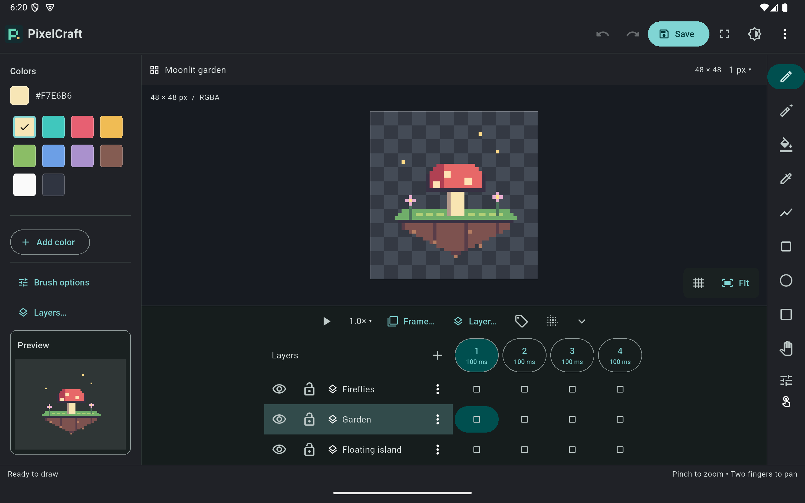
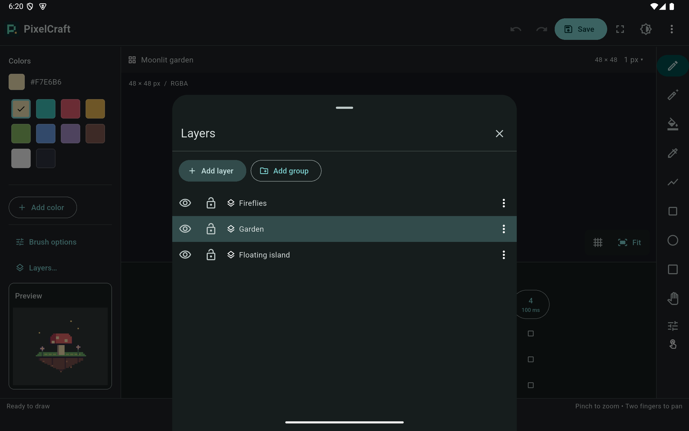
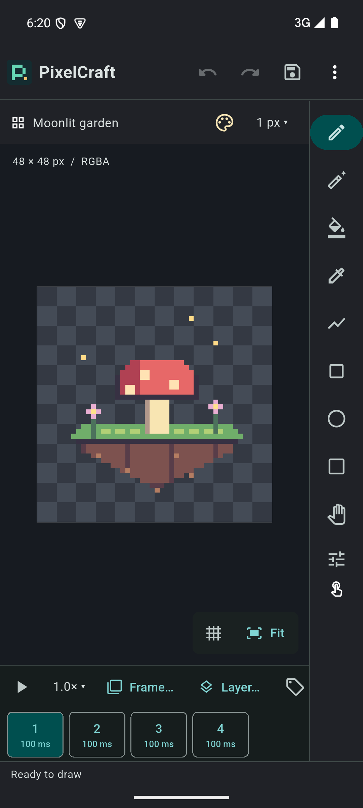
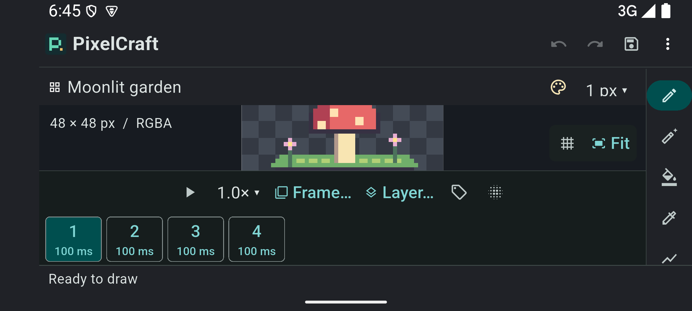
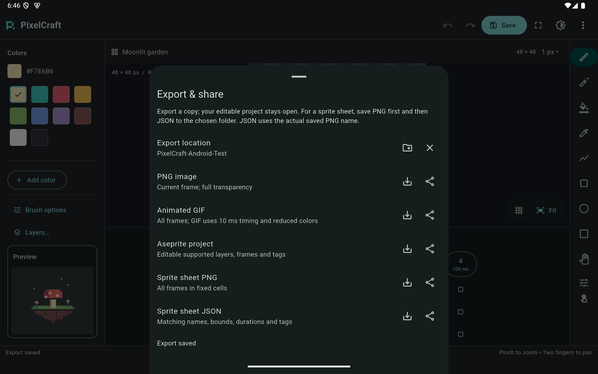
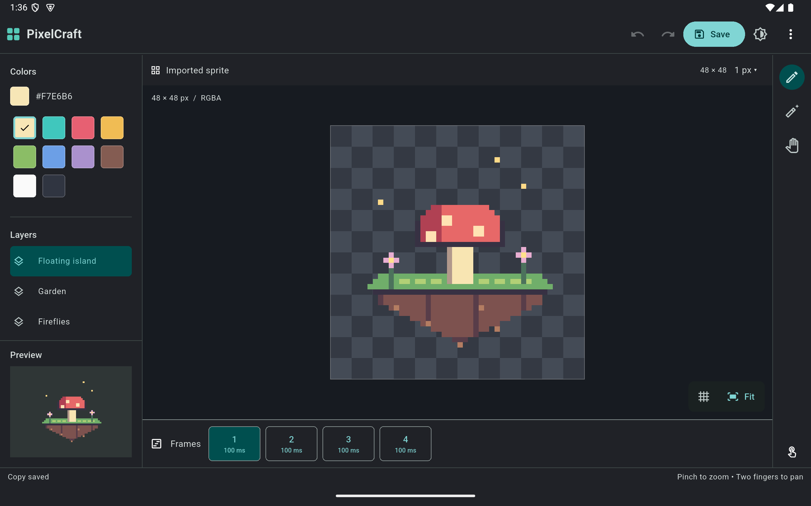
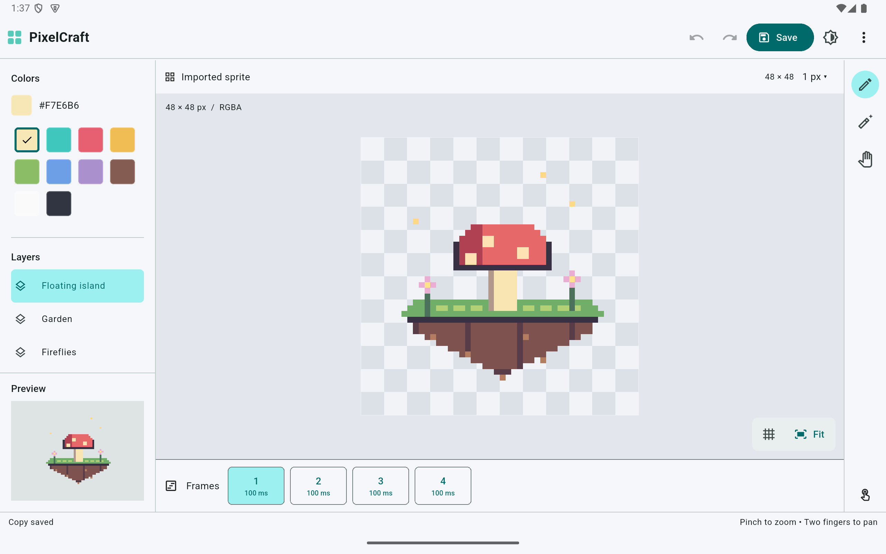
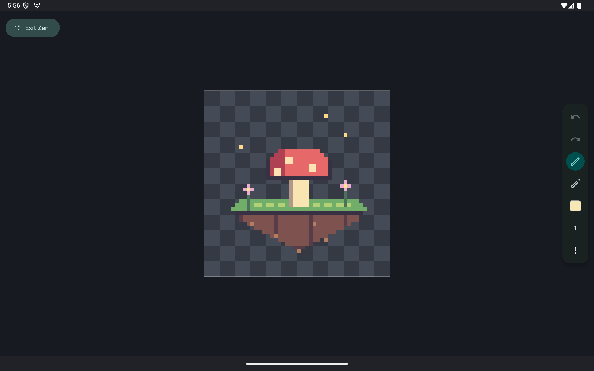

# Android validation — functional emulator phase and PoC

Issue: #29. Branch: `feature/tablet-android-proof-of-concept`.
Date: 2026-11-22. The current emulator phase is verified; physical tablet/phone
and stylus acceptance was subsequently verified in the physical-device sections below. The earlier PoC sections below
are historical evidence, not the current feature matrix. See the mobile README
for current format support and deliberate initial limits.

## Current functional emulator results

- Rust 1.95 workspace: **843 passed,16 ignored**. Strict workspace Clippy,
  rustfmt and dependency-boundary checks pass. Desktop standalone checks pass
  for drawing, native save/open, PNG/sheet/GIF, command edits and preferences.
- Flutter: **36 tests pass**, analysis clean. Covers colors, controls/layouts,
  keyboard, mouse/stylus input adaptation, Zen, recovery, lifecycle, playback,
  cancellation, stale work, export failures and paired filenames.
- Actual Android integration: **8/8 on API35 Pixel Tablet,8/8 on API35 Pixel7**.
  Drawing/Undo/Redo/multitouch cancel, compatible save/reopen, recovery, tools,
  selection transforms, layers/links, frames/tags/timing/playback, native
  interchange, indexed tiles/references and bounded256px editing pass.
- Tablet256-point stroke measured10ms; phone15ms. Playback probe observed50
  decoded canvas updates/800ms. These measure worker/update behavior, not
  display-presentation FPS or physical pen latency.
- Visual checks: tablet landscape, layer panel and export panel; phone portrait,
  landscape and1.5× Android text. Automated narrow/short layouts at2× text.
  Normal app reinstalled after integration; both emulators remain open.
- Universal debug APK includes arm64-v8a/x86_64 Flutter and Rust libraries;
  ELF16KiB alignment, ZIP16KiB alignment and APK v2 signature checks pass.
  Both emulator updates used install-r and retained private data.
- Actual SAF PNG export pulled back as48×48 RGBA PNG, then reopened through the
  cancellable descriptor-based Android picker read. Actual Android share
  chooser displayed the image with narrowly granted private-cache URI.
- Selected export folder survived process restart; Forget folder removed saved
  access. Two same-folder sheet exports produced separate PNG/JSON pairs;
  each JSON references its actual corresponding provider-disambiguated PNG.
- Code/security review fixes: bounded off-canvas linkedASE preflight; content-only
  SAF; correctASE extension; reference geometry/state publication; stale tile
  selection; eraser/Pan arbitration; active-layer controls; busy properties;
  import-cancel error preservation; provider filename coordination; responsive provider cancellation and post-recovery operation guards. Regression
  tests plus actual paired-export files verify these fixes.
- CI workflow is configured and locally validated, not claimed remotely run.
  Physical input/device performance, real cloud-provider accounts, production
  signing/upgrade channel and store/AAB distribution are not claimed tested.

## Physical phone verification — 2026-11-22

Pixel 10 Pro XL, Android 17/API 37, ARM64, 4 KiB pages, 1080×2404 at 390 dpi.
The preview was not installed in the checked profile before testing. Installed
the universal debug APK, ran the actual Rust/Flutter integration suite on ARM64,
then restored the normal universal app build: **8/8 workflows passed**.

The checks cover drawing, Undo/Redo, multitouch cancellation, private save/reopen,
recovery, shapes/fill/colors, selection transforms, layers/linked cels, frame names,
tags/timing/playback, native interchange, indexed tiles/references, and bounded
256px editing. Portrait and landscape/Fit layouts were visually inspected on the
phone. Original auto-rotation, stored rotation and font-scale settings restored.
The suite used generated preview fixtures rather than personal phone files.

Worker probe: 256-point stroke on a 256×256 canvas took 25 ms; playback produced
46 decoded canvas updates/800 ms. These are debug worker/update measurements,
not end-to-end physical touch latency or presentation FPS. Automated pointer events
on a physical device do not prove stylus/palm/pressure hardware behavior. No test
failures or observed crashes in this run. No application code change was needed.
Real tablet and stylus validation was subsequently completed in the section below.
No phone screenshots containing personal system UI were added to the repository.

## Physical tablet verification — 2026-11-22

Samsung SM-X716B, Android 16/API 36, ARM64, 4 KiB pages, natural 1600×2560,
340 dpi. All **8/8 integration workflows passed on the actual tablet**. Normal
universal debug APK restored afterward; no existing preview data was present
before the fresh install. Worker probe: 15 ms for the 256-point/256px stroke,
50 decoded canvas updates/800 ms playback. These do not measure display FPS or
physical tip-to-pixel latency. S Pen is available; a 64×64, 8px pressure-enabled
canvas was prepared for hands-on pressure, button, palm and navigation validation.
The user subsequently confirmed all manual checks pass: light/firm pressure
changes brush width, palm resting while drawing produces no stray marks/panning,
S Pen button drawing erases, Undo/Redo works, and two-finger zoom/pan works. This
completes milestone 14 for the documented preview scope alongside the physical
phone run. Pen behavior is user-confirmed, not an instrumented latency or FPS
measurement. The user's drawing was preserved. No code fixes were needed.

## Current screenshots

## Historical PoC: implemented batches

1. Versioned native ABI around the shared Rust `EditorSession`: bounded input,
   numeric session/buffer handles, stroke transactions, Undo/Redo, native project
   serialization and RGBA frames. Desktop decoder defaults remain unchanged.
2. Separate Android Flutter host: serialized worker isolate, tablet canvas,
   draw/erase, colors and brush size, layer/frame selection, zoom/pan/grid/Fit,
   bottom-left preview, Android private Save/Reopen and document picker.
3. Integration and safety: queued-edit protection, dirty Back confirmation,
   worker failure reporting, fixed canvas geometry during editing, widget and
   real-emulator tests, both themes, cross-host project verification.

## Historical PoC environment

Flutter 3.47.9 / Dart 3.13.7, Rust 1.95.0, Java 17, Android NDK 28.2.13676358.
Both x86_64 and arm64-v8a native libraries compile at minimum API 24 with 16 KiB
ELF load alignment requested by the linker. Only x86_64 runtime was exercised in this initial PoC; later ARM64 hardware results are above.
Pixel Tablet API 35 emulator: 2560 × 1600 physical, density 320, 1280 × 800 logical.
No emulator user data was wiped. The visible emulator remains running.

The emulator's automatic GPU renderer exited during installation. Restarting the
same AVD with SwiftShader restored it without clearing data. The system UI briefly
reported an ANR during software-rendered startup. The subsequent integration run
and normal application worked. Debug/software-rendered startup showed skipped
frames; this is not evidence of production rendering performance. Physical-device
latency, pressure and memory acceptance were pending at this PoC stage; later hardware results and measurement limits are recorded above.

## Historical PoC results

| Check | Result |
| --- | --- |
| Pre-change Rust workspace baseline | 811 passed, 0 failed; 16 opt-in ignores |
| Final Rust workspace | 818 passed, 0 failed; same 16 opt-in ignores |
| Core mobile decoder tests | 2 passed, included above |
| FFI contract/quota/rollback tests | 5 passed, included above |
| Workspace strict Clippy, all targets | Passed |
| Rust formatting and dependency boundaries | Passed; FFI cannot pull desktop/CLI/MCP |
| Desktop build | Passed |
| Standalone drawing/native save/open/exports | Passed |
| Headless CLI and MCP end-to-end checks | Passed without display environment variables |
| Opt-in live MCP tests | All 3 passed, separately from ordinary workspace run |
| Android native x86_64 / arm64-v8a builds | Passed |
| Flutter analyzer | No issues |
| Flutter widget/lifecycle/safety tests | 7 passed |
| Actual Android integration | 1 passed, about 8 seconds excluding build/install |

Widget checks cover 1280/390 logical widths at text scales 1 and 2, reachable
colors/file actions, no control overflows, Back confirmation, and the delayed
stroke/replacement race. Pending edits preserve canvas size and zoom.

The integration test loads the actual native library, draws through the canvas,
checks one history entry, verifies exact RGBA Undo/Redo, cancels the provisional
stroke on a second pointer, privately saves, opens a fresh document and reopens
the saved artwork with identical pixels. It rejects a path-like storage key and
malformed project data while preserving the current image. It switches themes.

Manual visual checks used the visible tablet throughout: demo artwork, drawing,
Undo, Save, named layers/frames, bottom-left preview and light/dark appearance.
An Android-saved `.pixel` file was pulled to the Linux host; desktop CLI inspect
and PNG export succeeded, preserving 48 × 48 dimensions, three layer names and
four 100 ms frame durations. The Android document picker also successfully
imported that project from Downloads. Save a copy through Android DocumentsUI
wrote a Downloads file byte-for-byte identical to the original native project
(SHA-256 checked). APK zip alignment at 16 KiB also passes; arm64 ELF LOAD
segments report 0x4000 alignment. Screenshots below show the actual app.

One debug emulator memory observation reported total PSS about 257 MiB and RSS
about 376 MiB. This single software-rendered debug sample is not a physical-device
budget or benchmark. Native per-project decode/history limits are documented in
the preview README.

## Review loops

Independent native code/security review found and fixed runtime sparse raster
quota bypass and inconsistent save/reopen payload limits. Rollback regressions
cover runtime quota failure and rejected serialization at stroke finish. Handles,
input batches, names, raster storage and native buffers are bounded.

Independent Flutter/Android review found and fixed silent dirty Back exit,
replacement actions racing an unfinished stroke, canvas refitting when progress
changed its height, and requests hanging after a worker failure. Error paths no
longer delete a document-provider URI after a failed external copy. Final source
re-review reported no remaining blockers for this PoC scope. No new network or
broad storage permission is required for the main application; debug Flutter
service permissions follow the generated debug manifest.

This was code/security review of the new boundary and host, not a refreshed
external-dependency vulnerability scan. The existing dependency advisory snapshot
was not refreshed.

## Remaining issue #29 work

Physical tablets and styluses; phone/device-specific interaction; sustained
performance and low-memory tests; autosave/process-death recovery; the full tool,
format/export and animation UI; production Android packaging/signing and release
CI. Existing desktop CLI/MCP remain available; Android does not host them in this
preview. Keep issue #29 open.

## Actual tablet screenshots

## Zen drawing mode (2026-11-22)

The normal debug app was reinstalled after integration tests and visually
inspected on the running tablet emulator. Zen hides the inspector, preview,
timeline and app bar, retaining essential drawing controls and an explicit exit.
The canvas remains centered with its zoom preserved. System navigation remains
visible; Back restores the editor. Emulator left open in Zen for manual testing.

20 Flutter tests and analysis pass. Five actual tablet integration workflows
pass, including touch drawing/Undo in Zen and returning to normal Preview.
Review fixes cover canceling an in-progress draft on Exit and retaining pixel
visibility settings. No remaining Zen-specific review findings. Physical device
and stylus checks were deferred for this early batch; subsequent hardware results are above.
