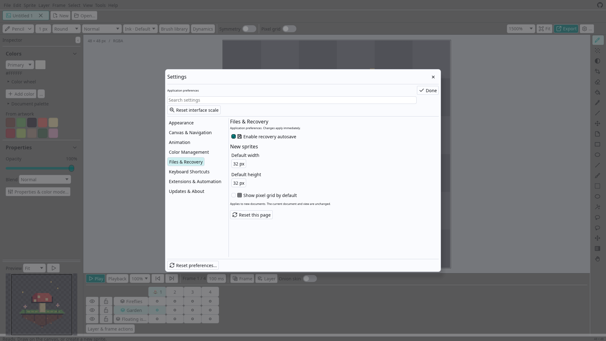

# Finding commands and preferences

Menus follow the editor's objects: File, Edit, Sprite, Layer, Frame, Select, View, Tools and Help. Commands that need more input end with an ellipsis. Unavailable commands explain their current constraint. Long menus scroll, including when navigating with Tab; Enter activates the focused command.

Open command search with Ctrl+Shift+P (Command-Shift-P on macOS). Former menu names remain searchable, alongside new category paths and setting aliases. Searching does not decode files or process canvas pixels.

## Common tasks

| Task | Destination |
| --- | --- |
| Theme, spacing or interface size | Edit → Settings → Appearance |
| Transparency checkerboard or wheel zoom | Settings → Canvas & Navigation |
| Onion counts, tints or opacity | Settings → Animation |
| Display ICC profile and image import policy | Settings → Color Management |
| Current sprite's color profile | Sprite → Color Profile |
| Autosave/recovery or new-sprite defaults | Settings → Files & Recovery |
| Custom key bindings | Edit → Keyboard shortcuts; also linked from Settings |
| Installed asset packages | Tools → Asset extensions; also linked from Settings |
| Reference images | Tools → Reference images |
| Document palette and snapping | Tools → Palette tools; also the Inspector's Palette tools button |
| Brush capture and drawing options | Tools → Brushes and selection; active-tool options stay in the drawing bar |
| Fill tolerance | Select Fill on the right, then Fill options in the drawing bar |
| Import cells from a sheet | File → Import → Import sprite sheet |
| Export a sheet | File → Export sprite sheet |
| Export every animation tag | File → Export animation tags |
| Pack several sprites into an atlas | File → Export multi-file atlas |
| Current sprite mode, grid, pixel aspect and slices | Sprite → Sprite properties |
| Canvas and sprite dimensions | Sprite → Canvas size / Sprite size |
| Layer/group membership and cel appearance | Layer → Layer properties |
| Frame duration and animation ranges | Frame → Frame and animation properties |
| Tilesheet capture and tile-layer setup | Sprite → Tileset tools |
| Live-editor assistant access | Tools → Assistant access; also linked from Settings |
| Show panels or restore layout | View for Inspector/Preview visibility; View → Layout for split/reset |

The old Workflow tools action remains as a destination index. Settings links to existing asset, shortcut and About dialogs without leaving two dialogs stacked; closing the linked destination returns to the originating Settings page.

## Settings search and scope

Settings remembers the last category. Search matches labels, descriptions and aliases such as “autosave”, “transparency background”, “DPI” and “next tint”. A result shows its category path and reveals/focuses the actual control. Clear returns to normal category navigation without changing values. Wide windows show a category list; narrow windows use a category selector and scrolling content.

On macOS, **PixelCraft → Settings…** also opens this destination. Command-Comma is its default shortcut; an explicit custom assignment takes precedence, while the menu entry remains clickable. Windows/Linux retain **Edit → Settings** and the default Ctrl+Comma shortcut. Ctrl+Shift+0 (Command-Shift-0 on macOS) restores interface scale unless that chord has been assigned elsewhere; the visible recovery button remains available.

App preferences describe future documents, display behavior or default tools. They do not silently change the open sprite. Sprite, layer and frame properties apply to the current object and use the existing document validation and Undo history. A properties dialog closes if its target document, layer or frame changes, rather than applying an edit to another object.

Sheet scale, packing and import geometry belong to the current export/import task. The Inspector stays left, drawing tools right and Preview bottom-left. Window decorations remain native.

## Reset and recovery

| Action | Scope |
| --- | --- |
| Reset this page | That category's app defaults only. Appearance also restores System theme and removes the applied custom override. Installed theme assets remain. |
| Reset preferences… | Confirmed combination of app category defaults. Preserves recent files, export presets, tool preferences, custom shortcuts, installed assets, documents, Undo/Redo, current document/view settings and assistant access. |
| Reset interface scale | 100% app interface zoom, following the system's display scaling. Canvas zoom and artwork are unchanged. |
| View → Layout → Restore default layout | Shows the Inspector and bottom-left Preview, restores Inspector/timeline panel dimensions, resets Preview size/zoom/pan and removes the current split canvas. Artwork and history remain. |

Live assistant access remains an explicit opt-in for the current running editor. Opening a destination, searching, restoring layout or resetting preferences never enables it. The private bridge file contains an access token; only its command/path is displayed. Turning access off retains existing cancellation and revision checks.

## Verification

Implementation and review evidence, including test commands, task walkthroughs, synthetic display-scale captures and platform limits, is recorded in [the execution plan](superpowers/plans/2026-11-19-menu-settings-discovery.md). Synthetic DPI tests exercise egui at the requested physical dimensions; they do not substitute for physical monitor transitions or observations from artists.

<picture>
  <source media="(prefers-color-scheme: dark)" srcset="../shots/settings-dark.png">
  <source media="(prefers-color-scheme: light)" srcset="../shots/settings-light.png">
  
</picture>
